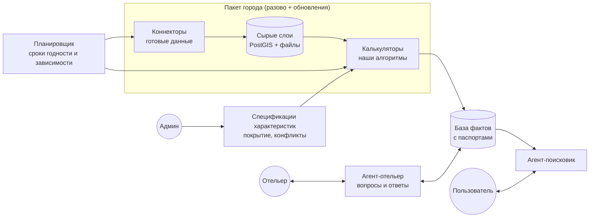

# Концепт продукта

Статус: **v1 принят за основу 23.10.2026** (D11). Рабочее название — «О!знаю». Решения, которые ещё ждут исследований, отмечены ⏳ и перечислены в `docs/questions.md`.

## 0. Чего ждут организаторы и наш ответ (D30)

> **D30, 24.10:** центр — пять обязательных пунктов трека по всему каталогу из 80 характеристик. Путь «хочу → бронь» ниже — это подача, а не центр. «Бронь с обещанием» снята: в конце просто кнопка брони на Островке с листом условий. Сверка — `docs/research/track_alignment.md`.

**Эксперт трека Ilia Marashli в чате, 23.10** (подробно — `docs/organizers_chat.md`):
- суть трека не в DS;
- цель — соединить желание человека с конкретным отелем: **путь от «хочу» до «бронь» простой, без разочарований на месте, с минимумом усилий**;
- обязательный «фундамент» — система знает об отеле то, чего нет в карточке, и говорит, откуда знает;
- всё остальное можно переизобрести: ввод желания (диалог, картинки, «найди похожий»), роль отельера, момент бронирования, весь флоу.

**Наш фундамент закрывает обязательную часть:** факты с паспортами, вычисленные признаки, отельер. Предлагаем достроить продукт до полного пути «хочу → бронь → поездка без разочарований»:

1. **«Хочу» — любым способом:**
   - диалогом с уточнениями (как сейчас);
   - фото: «хочу такой вид» — модель с vision разбирает картинку в те же условия AST;
   - «вот этот отель понравился — найди похожий»: сходство по нашим фактам (вид, тишина, путь до моря…), а не по тексту описания.
2. **«Я понял»** — пользователь видит и правит разобранные условия: обязательно, желательно, неважно.
3. **Выдача с доказательствами:** что подтверждено, что оценка, что неизвестно. Блок «надо уточнить» с вопросом отельеру одной кнопкой.
4. ~~**Бронь с обещанием.**~~ *Снято D30. Вместо этого (D31) — имитация встроенного оформления Островка: условия рядом с тарифом, постоянная пометка «Имитация оформления Островка. Реальная бронь не создаётся».* Было: В момент бронирования показываем **карточку обещания**: что гарантировано для этой категории и размещения, а что лишь возможно. Если обязательное условие зависит от размещения (вид на море, низкий этаж), система автоматически просит отельера закрепить подходящий номер и показывает статус подтверждения.
5. **Перед поездкой** — перепроверка: стройки и события на даты, свежесть часов работы, погода.
6. **После поездки** гость одним касанием подтверждает или опровергает ключевые факты («вид был?», «тихо было?»). Ответ становится новым доказательством и замыкает цикл качества.
7. **Новая роль отельера:**
   - отельер видит, что гости ищут и чего система о нём не знает (спрос на неизвестные факты);
   - отвечает один раз вместо десятков переписок;
   - получает бейдж «проверено».

**Демо-данные** кладём в репозиторий, **описываем процесс получения** каждого небазового факта: паспорт факта + `manifest.json` пакета + раздел README. Базовые характеристики карточки Островка разрешено замокать. У нас они реальные — со страниц сайта (D24).

## 1. Идея в одном абзаце

Мы собираем и храним у себя **базу проверяемых фактов об отелях и номерах** — того, чего нет в карточках. Факты бывают трёх видов:
- **готовые данные** — скачиваем;
- **вычисленные** — считаем своими алгоритмами по геоданным;
- **данные отельера** — спрашиваем.

У каждого факта есть «паспорт»: откуда он, как получен, насколько надёжен, когда устареет. Пользователь пишет пожелание своими словами. LLM переводит его в структурный запрос, система находит отели **по нашим фактам** и объясняет, что подходит, что нет и что неизвестно. Система работает в нескольких городах сразу. Объём данных в городах разный, и это нормально: где данных мало, характеристика считается проще или уходит вопросом отельеру, а покрытие по каждому городу видно в админке.

## 2. Пять принципов

1. **Все факты — у нас. LLM — не источник фактов.**
   LLM делает только четыре вещи:
   - переводит запрос пользователя в структуру;
   - раскладывает ответ отельера по полям;
   - превращает текстовое описание новой характеристики в спецификацию;
   - объясняет результат, опираясь только на наши факты.
   
   Ни одно значение не придумывается моделью.
2. **У каждого значения есть паспорт:** источник, способ получения, уверенность, дата наблюдения, срок годности, и к чему именно оно относится — отелю, зданию, стороне здания, категории номера.
3. **Одна характеристика — несколько рецептов получения.** Рецепты упорядочены от лучшего к худшему. В каждом городе срабатывает лучший доступный.

   **Запасной рецепт обязан давать значение того же смысла (D15).** Пример: «пешком до пляжа» — маршрут по графу с рельефом → расстояние по прямой с явной пометкой → ответ отельера.

   Если смысл другой, это **другая характеристика**. Так, «шум» — это три разных признака:
   - `outdoor_ln_db` — дБ только из официальной карты;
   - `road_exposure` — факторы окружения: трассы, ж/д, бары;
   - `indoor_quiet` — замер или ответ отельера.

   Где нет карты, `outdoor_ln_db` = «неизвестно», а поиск по «тихо» опирается на `road_exposure` и `indoor_quiet` и прямо об этом говорит.
4. **Три ответа: да, нет, неизвестно.** Неизвестное не превращается в догадку. Оно выводится честно, а система ставит вопрос отельеру. Обязательное условие пользователя проходит только при «да».

   **Оценка (D18, принято).** Иногда данных хватает на грубое, но полезное значение, например «спуск к морю ~30–50 м» по рельефу 30 м. Тогда факт получает статус «оценка» с бейджем и причиной:
   - в обязательных условиях оценка не участвует;
   - в мягком ранжировании и в карточке — участвует.
   
   Так города уровней B и C не будут пустыми, и система не подменяет знание догадкой.
5. **Город — это пакет.** Город один раз глубоко исследуется и упаковывается в версионированный пакет, после чего обновляется только то, что быстро меняется. ⏳ Подход ждёт подтверждения исследованием.

## 3. Виды данных (D7 + D33)

| Вид | Что это | Как получаем | Сложность | Уверенность по умолчанию |
|---|---|---|---|---|
| **А. Готовые** | **Каталог Островка/ETG: отели, категории номеров, удобства, политики (основа, D24).** **Данные карт Google, 2ГИС, Яндекса (D35): места, кухня, рейтинги, маршруты с пробками, панорамы.** Здания и этажность, рельеф, POI и часы работы, дороги и лестницы, пляжи, транспорт (GTFS), погода и климат, море, воздух, связь, история зданий, официальные реестры, городские порталы | **Коннекторы**: скачать, нормализовать, привязать к отелям | Низкая, массовая | По источнику: официальный — высокая, OSM — средняя |
| **Б. Вычисляемые** | Вид из окна, солнце, шум по сторонам, пешие маршруты с подъёмами и лестницами, что открыто в момент приезда, дорога из аэропорта, зелень и тень и т.д. | **Калькуляторы**: наши алгоритмы поверх готовых данных, каждый со своей версией и тестами | Высокая, это наш главный вклад | Зависит от качества входных данных; хранится с интервалом и причиной |
| **В. От отельера** | Всё внутри номера: какая категория на какую сторону и этаж, blackout, кондиционер, шумоизоляция, питомцы, поздний заезд, парковка, Wi-Fi, стол, лифт, доступность | **Агент-отельер**: вопросы, ответы свободным текстом, разбор по полям | Средняя | «Со слов отельера». Сверяется с вычисленным |
| **Г. Ручная обработка командой с ИИ (D33)** | То, что автоматика не собирает и алгоритм не считает: сопоставление отель ↔ здание при неуверенности, входы на пляж и покрытие, проверка вида по уличным фото, извлечение из текстов Островка, стройки и события, черновая привязка категорий к сторонам здания | **Разово по городу** (D6): нейронка, скрипт или Codex предлагает кандидата с доказательством → человек принимает, исправляет или отклоняет | Средняя, ручная | «Проверено командой». Без проверки человеком — только кандидат |
| Д. Тексты (опционально) | Сайты отелей, описания, отзывы там, где это законно | Извлечение LLM как подсказка | Средняя | Низкая: только сигнал и повод для вопроса ⏳ законность |

## 4. Каталог характеристик

**Вид и шум — только две из многих.** Каталог открыт: новые характеристики добавляются текстом (раздел 9). Буквы в скобках — вид данных из раздела 3.

| Семейство | Примеры характеристик |
|---|---|
| **Вид и окна** | Вид на море, горы, достопримечательность или парк с фасада и этажа (Б). Закат или рассвет из окна (Б). Окна во двор, на улицу или в стену (Б+В). Какие категории на какую сторону (В) |
| **Солнце и климат в номере** | Часы прямого солнца по месяцам (Б). Риск перегрева (Б+А климат). Кондиционер и его управление (В). Полное затемнение (В) |
| **Тишина** | Уличный шум по сторонам здания (А там, где есть карта; Б модель). Ночная жизнь рядом (А+Б). Ж/д и аэропорт (А+Б). Стройки рядом (А там, где есть портал). Шумоизоляция и тишина внутри (В) |
| **Пешая доступность** | До моря, набережной, центра, метро или остановки, достопримечательностей: длина, время, подъём, лестницы, переходы через оживлённые дороги (Б) |
| **Транспорт** | Из аэропорта и вокзала: время, пересадки, работает ли ночью (А GTFS + Б; без GTFS — упрощённо или В). Парковка и зарядки (А+В) |
| **Рядом и ночью** | Круглосуточные аптеки, магазины, еда; что открыто в момент приезда (А+Б). Супермаркет, рестораны (А) |
| **Семья** | Площадки, детская больница, пешеходные улицы, путь к пляжу без трассы (А+Б). Детская кроватка, смежные номера (В) |
| **Питомцы** | Правила: вид, вес, доплата (В). Парки и места для выгула, ветклиники рядом (А+Б) |
| **Маломобильным** | Путь без ступеней до пляжа и транспорта (Б). Вход, лифт, пороги, душ (В) |
| **Удалённая работа** | Фон связи в районе (А). Скорость Wi-Fi в номере и рабочий стол (В). Коворкинги и кафе рядом (А) |
| **Пляж и море** | Тип пляжа: песок или галька (А). Температура воды по месяцам (А). Волны (А). Качество воды и флаги там, где есть (А) |
| **Погода и сезон** | Климат по месяцам, солнечные и дождливые дни, «купаются ли в октябре» (А) |
| **Среда** | Воздух, пыльца, зелень вокруг, острова тепла, засветка неба (А+Б) |
| **Безопасность** | Статистика района там, где публикуется; ДТП; освещённость пути (А+Б) |
| **Здание и история** | Год постройки, охраняемое наследие, «бывшая фабрика», этажность (А) |
| **События и стройки** | Фестивали, перекрытия, круизы в даты поездки (А там, где есть порталы) |
| **Номер** | Две кровати, балкон, кухня, чайник, сейф (В) |

## 5. Разные города — разный объём данных

Каждый город получает **уровень данных**. Уровень влияет только на рецепты и уверенность, поведение системы одно и то же.

Уровень задаётся **по каждому слою отдельно**: здания, рельеф, POI, транспорт, связь категорий с размещением. Например, у Сочи здания — B, транспорт — C. Общий бейдж города — только сводка (D13, отчёт v2).

**Фокус (D36): Москва и Большой Сочи — полная глубина; остальные 6 — автоматический слой.** Стартовые 8 городов (D13): Москва, Петербург, Большой Сочи (центр, Адлер, Сириус, Красная Поляна, Лазаревское, Лоо, Дагомыс, Хоста и другие посёлки — D28), Казань, Калининград, Минск, Стамбул, Дубай. Замена Дубаю — Батуми.

| Уровень | Пример | Как работают характеристики |
|---|---|---|
| **A — богатые официальные данные** | Барселона, Париж | Высоты из кадастра или лидара, официальный шум по фасадам, GTFS, порталы строек и событий → высокая уверенность |
| **B — хороший OSM плюс глобальные наборы** | Москва, Петербург, Сочи (у 52–74% зданий есть этажность) | Вид и солнце там, где есть высоты; шум — наша модель; транспорт — GTFS там, где есть → средняя уверенность, больше вопросов отельеру |
| **C — данных мало** | Стамбул, Анталья, Дубай, Пхукет (этажность у 3–6%) | Высоты из глобальных наборов ⏳ лицензия; много «неизвестно» и вопросов отельеру → честно меньше подтверждённых фактов |

В админке для каждого города показывается **покрытие**: по каждой характеристике доля отелей со значениями «подтверждено», «вычислено», «со слов отельера» и «неизвестно». Это одновременно метрика качества из брифа и наглядное объяснение разницы между городами.

## 6. Как устроено

**Объекты.** Город → отель → здание (корпус) → сторона здания (фасад) → категория номера. Факт привязывается к тому уровню, к которому реально относится:
- «пляж в 400 м» — к отелю;
- «море видно с 4-го этажа» — к фасаду;
- «в Standard окна во двор» — к категории.

Связь «категория → стороны и этажи» даёт отельер. Без неё обещание на уровне номера не выдаётся.

**Паспорт факта** (упрощённо):

| Поле | Значение |
|---|---|
| `объект` | Уровень и ID |
| `характеристика`, `значение`, `единица` | Значение может быть интервалом |
| `статус` | `подтверждено`, `вычислено`, `оценка`, `данные_Островка` (D26: годится для обязательных условий), `проверено_командой` (D33: обработано с ИИ, проверено человеком), `со_слов_отельера`, `имитация_отельера`, `неизвестно` (с причиной), `неприменимо` (например, моря нет) |
| `уверенность` | Высокая, средняя или низкая — **с причиной** |
| `источники`, `рецепт`, `версия_алгоритма` | Происхождение и лицензия |
| `дата_наблюдения`, `дата_расчёта`, `годен_до` | Разные даты, не дата скачивания |
| `зависит_от` | ID входных данных для точечного пересчёта |
| `оговорка` | Например: «только для этажей 5+, западный фасад» |

Противоречия хранятся отдельно, со ссылками на оба факта, и проходят цикл «обнаружено → ждём доказательство → разрешено».

## 7. Агенты: где LLM, а где код

| Агент | Что делает | LLM | Код |
|---|---|---|---|
| **Исследователь характеристик** | По спецификации характеристики выбирает лучший рецепт, доступный в городе, запускает коннекторы и калькуляторы, пишет факты. При низкой уверенности ставит вопрос отельеру | Выбор рецепта и инструментов по спецификации и доступным данным | Все расчёты детерминированные |
| **Агент-отельер** | Группирует и приоритизирует вопросы. Задаёт их, разбирает свободные ответы по полям, находит противоречия с вычисленным | Формулировки, разбор ответов | Валидация полей, обнаружение конфликтов |
| **Агент-поисковик** | Разбирает запрос и уточняет неоднозначное. Ищет по фактам, ранжирует, объясняет «почему подходит и где не дотягивает» | Разбор запроса в структуру, текст объяснения | Фильтры да/нет/неизвестно, ранжирование, SQL |
| **Контролёр** (без LLM) | Сроки годности, пересчёт зависимых фактов, очередь перепроверки | — | Планировщик |

## 8. Поиск: пример

**Запрос:** «Сочи, невысокий этаж, вид на море и чтобы не было солнца днём».

1. **Разбор (LLM).**
   - Жёсткое: этаж ≤ 3 (нужна связь категорий с этажами).
   - Мягкое: вид на море — вес 0,6; мало прямого солнца днём — вес 0,4.
   - Если даты поездки не указаны, система их уточняет: солнце зависит от месяца.
2. **Поиск по фактам (код).** Отели, где этаж ≤ 3 — «да», идут в основную выдачу. Где «неизвестно» — в отдельный блок «надо проверить». Затем ранжирование по мягким условиям.
3. **Объяснение (LLM строго по фактам).**
   > «Море видно с 3-го этажа юго-западного фасада. В июле на этот фасад прямое солнце с 13:00 до заката.
   > Без солнца — северо-восточная сторона, но там вид на горы.
   > Привязку категории Standard к этажам отель не подтвердил — мы спросили.»

## 9. Новая характеристика без переписывания системы

**Описание админа:** «Добавь вид на Олимпийский парк из номера».

1. LLM превращает текст в спецификацию: цель — полигон Олимпийского парка из OSM; калькулятор — «видимость цели» (уже есть); привязка — фасад и этаж; срок годности; рецепт-запасной — вопрос отельеру.
2. Валидатор проверяет, что все калькуляторы и поля существуют, а единицы согласованы.
3. Характеристика считается для всех отелей города и сразу показывает покрытие.

Если нужен **новый алгоритм**, например «сила ветра на балконе», разработчик добавляет калькулятор как плагин. Ядро не меняется.

## 10. Пакет города и обновления

1. **Список отелей:** OSM плюс официальные реестры, дедупликация. ⏳ Где брать категории номеров — исследование v3.
2. **Коннекторы** скачивают готовые слои по городу.
3. **Привязка:** отель → здания → стороны здания.
4. **Калькуляторы** по всем характеристикам.
5. **Отчёт покрытия** и очередь вопросов отельерам.
6. **Упаковка:** версия и манифест источников с лицензиями и хешами. Приложение загружает пакеты при старте, поэтому выполняется правило хакатона «данные в репозитории, запуск ≤ 10 минут».

**Обновления по типам данных** (начальная политика):

| Данные | Как часто |
|---|---|
| Здания, рельеф | Раз в квартал |
| POI и часы работы | Раз в неделю |
| GTFS | Раз в неделю или ежедневно |
| Стройки и события | Ежедневно |
| Погода | Прогноз по запросу; климат — в пакете |
| Ответы отельера | По событию. Срок переподтверждения — по характеристике (`ttl_days` в спецификации): размещение категорий ~180 дней, доплата за питомца ~7 дней, доплаты и депозиты — до срока котировки |

При изменении входных данных пересчитываются только зависимые факты.

## 11. Интерфейсы

- **Гость:**
  - поиск текстом;
  - выдача со статусами соответствия **«Подходит / Нужно уточнить / Не подходит»** (D31); источник — подписью: «подтверждено / вычислено / со слов отельера / Данные Островка / оценка»;
  - последний шаг — **имитация встроенного оформления Островка** с постоянной пометкой; после — «Забронировано» и важные условия поездки (D31);
  - карточка отеля с фактами и источниками;
  - сравнение отелей.
- **Отельер:**
  - что система знает об отеле;
  - подтвердить или исправить значения;
  - ответить на вопросы.
- **Админ:**
  - города и покрытие;
  - спецификации характеристик и добавление новых текстом;
  - противоречия;
  - метрики качества.

## 12. Стек и масштабирование

Простое ядро и точки расширения под enterprise. ⏳ Финальный стек — после исследования v2.

**Ядро:**
- **Backend:** Python + FastAPI. Один образ, два режима: API и worker для коннекторов и калькуляторов.
- **БД:** PostgreSQL + PostGIS — факты, геометрия, очереди на старте.
- **LLM:** через OpenAI-совместимый шлюз (`LLM_BASE_URL`, `LLM_API_KEY`, `LLM_MODEL`). Можно YandexGPT, GigaChat или self-hosted.
- **Фронтенд:** одна SPA с тремя ролями.

**Почему масштабируется:**
- города независимы и собираются параллельно;
- данные разбиты по `city_id`;
- API без состояния — масштабируется горизонтально;
- калькуляторы — плагины с версиями;
- дальше можно вынести очереди и объектное хранилище, не меняя модель данных.

**Enterprise:**
- роли (гость, отельер, админ);
- аудит изменений фактов;
- версии спецификаций и алгоритмов;
- манифест лицензий;
- логи в stdout и метрики.

## 13. Чего не делаем

- Не спрашиваем LLM о фактах и не выдаём догадку за знание.
- Не скрейпим OTA вопреки их правилам: например, Booking A15 это запрещает.
- Не обещаем на уровне номера без подтверждённой связи категории со стороной и этажом.
- Не пишем децибелы и «тихо» там, где есть только косвенные признаки. Показываем факторы и уровень уверенности.
