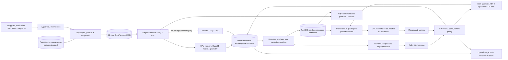

# Многогородская система поиска отелей

Дата отсечения источников: **23 октября 2026 года**. `[факт]` обозначает сведения из указанного первичного источника; `[факт: команда]` — переданные командой наблюдения; `[вывод]` — предлагаемое решение, расчётное допущение или будущий критерий приёмки. Настоящий документ — исследование, архитектура и план; программная система в рамках этой работы не реализована.

[вывод] **Строить следует единую многогородскую систему с версионированными пакетами городов, инкрементальными обновлениями и структурированными ответами отельеров.** Рекомендуемый старт: Москва, Петербург, Большой Сочи с центром, Адлером и Сириусом, Казань, Калининград, Минск, Стамбул и Дубай. Разница между городами выражается в доступных рецептах и измеренном покрытии каждой характеристики. Она не требует разных приложений и не оправдывает вымышленные значения. Геометрия, маршруты, климатический фон и разрешённые POI рассчитываются заранее; комнатные обещания требуют подтверждённой связи категории с корпусом, стороной и этажом. Локальная поставка и промышленное развёртывание используют одну кодовую базу и одинаковые контракты. Следующий инженерный шаг — зафиксировать каталог, права и спецификации, собрать первые пакеты всех восьми городов и измерить качество, стоимость и задержки.

[вывод] Физические методики сохраняются из [предыдущего отчёта: геометрия, вид, солнце, шум и маршруты](</Users/turgov/Хакатон/reports/Исследование для хакатона Островка.md#блок-3-надёжность-возникает-из-физических-расчётов-и-границ-обещания>), включая его блок доказательств, конфликтов и текстового расширения; [30 размеченных запросов](</Users/turgov/Хакатон/reports/Исследование для хакатона Островка.md#блок-4-тридцать-запросов-проверяют-условия-компромиссы-и-отказ>) переиспользуются как часть регрессионного корпуса. Здесь развивается масштабирование, а прежнее ограничение одним регионом и 10–15 корпусами отменяется. Исходная постановка зафиксирована в [handoff v2](</Users/turgov/Хакатон/handoff_chatgpt_v2.md>), [дополнении](</Users/turgov/Хакатон/handoff_chatgpt_v2_addendum.md>) и [каталоге характеристик, §4](</Users/turgov/Хакатон/docs/concept.md#4-каталог-характеристик>).

## 1. Восемь городов подключаются одним конвейером, а покрытие считается по характеристикам

### 1.1. Выбор географии опирается на спрос и разнообразие условий

[факт] В итогах Островка за 2025 год первые пять российских направлений — Москва, Петербург, Сочи, Казань и Калининград; Беларусь возглавляет зарубежный список стран. Это разные основания: страновой рейтинг не доказывает первое место Минска среди городов. [Итоги Островка](https://blog.ostrovok.ru/trevel-itogi-2025/). [факт] В отдельном новогоднем срезе OneTwoTrip Стамбул получил 7,2% зарубежных бронирований, Дубай — 6%, Пхукет — 4,4%; переносить эти доли на годовой рынок нельзя. [Релиз OneTwoTrip](https://www.onetwotrip.com/ru/landings/about/news/pageNews/winter-holidays-2025/).

[факт: команда] Доли зданий с `height` либо `building:levels` переданы в [замере команды](</Users/turgov/Хакатон/research/region_choice.md>). Это туристические прямоугольники разного размера; точные bbox, запрос и время снимка не приложены. Измерена заполненность тегов, а не точность высот и не покрытие гостиничного каталога. В таблице ниже эти данные используются как вход выбора, а не как независимо воспроизведённый аудит. `[вывод]` относится ко всем предлагаемым уровням и решениям.

| Все 16 рассмотренных кандидатов | Решение | Предварительный уровень и основание |
|---|---|---|
| **Москва** | **Старт**: масштабный городской каталог | **B**. Команда: 20 635 / 27 816 ≈74% зданий с высотой/этажностью. Официальный принятый 3D-набор не подтверждён, поэтому A не присваивается |
| **Петербург** | **Старт**: исторические корпуса, дворы, сезонное солнце | **B**. Команда: 8 334 / 15 190 ≈55%; расписания проверяются отдельно |
| **Большой Сочи: центр, Адлер, Сириус** | **Старт**: море, рельеф, курорт и несколько подзон | **B/C по признаку и подзоне**. Центр: 14 832 / 28 333 ≈52%; Адлер/Сириус: 7 920 / 22 471 ≈35%. Три подзоны имеют отдельные счётчики |
| **Казань** | **Старт**: популярный город без готового командного аудита | **C, предварительно**. После выгрузки и QA отдельные признаки переходят в B; хорошая репутация города не заменяет измерение |
| **Калининград** | **Старт**: отдельный городской и балтийский контекст | **C, предварительно**. Береговые курорты не включаются в городскую границу молча |
| Нижний Новгород | Следующая волна | **C, предварительно**. Тот же конвейер; дополнительный городской сценарий с рельефом |
| Краснодар | Следующая волна | **C, предварительно**. Нет командного аудита; принадлежность краю не делает город морским курортом |
| **Минск** | **Старт**: белорусское направление и трансграничный каталог | **C, предварительно**. Нет принятого городского аудита зданий/GTFS; стартуют независимо доступные признаки |
| **Стамбул** | **Старт**: зарубежный мегаполис и слабая открытая этажность | **C по 3D**. Команда: 1 907 / 64 455 ≈3%; официальный кандидат IETT ещё не принят как действующее расписание |
| Анталья | Следующая волна | **C**. Команда: 1 536 / 28 304 ≈5%; обнаруженная ошибка bbox одного GTFS требует карантина этого фида |
| **Дубай** | **Старт**: высотная застройка при дефиците открытых атрибутов | **C**. Команда: 5 704 / 91 031 ≈6% в Marina–Downtown; непосредственно `height` — у 2 150 зданий |
| Батуми | Следующая волна; первая замена Дубаю при провале обязательного gate | **C**. Команда: 3 975 / 16 406 ≈24%; морской/горный сценарий частично пересекается с Сочи |
| Тбилиси | Следующая волна | **C, предварительно**. Нет командного аудита; железнодорожный feed страны не заменяет городской транспорт |
| Пхукет | Следующая волна: отдельная проверка Google 2.5D | **C**. Команда: 120 / 4 673 ≈3% только в Патонге, а не на всём острове |
| Ереван | Следующая волна | **C, предварительно**. Нужен тот же аудит; популярность страны не измеряет городской каталог |
| Алматы | Следующая волна | **C, предварительно**. Горный мегаполис расширяет сценарии; качества высот заранее не известно |

[вывод] Стартовый набор из восьми городов сохраняет первые пять внутренних направлений и добавляет три разных зарубежных случая. Замена Дубая Батуми допускается решением владельца продукта при недоступности разрешённого обязательного каталога, а не только из-за низкой этажности. Город C всё равно полезен: работают известные POI, часть маршрутов, сезонность, правила питомцев и оснащение от отельера. Барселона остаётся внешним примером для сравнения официальных данных, а не обязательным туристическим направлением первого выпуска.

[вывод] Латинские **A/B/C — уровни данных города**: A требует принятого официального набора нужного масштаба и качества; B использует проверенные OSM и глобальные продукты; C опирается на ограниченные глобальные входы и сведения отельера. Кириллические **А/Б/В — способы получения данных**: А готовые, Б вычисляемые, В от отельера. Это независимые оси. Внутри `city_version` хранятся `tier_buildings`, `tier_terrain`, `tier_poi`, `tier_transit`, `tier_room_mapping`; единый бейдж города остаётся обзором. Ни одному российскому городу здесь не присвоен A без принятого официального источника.

### 1.2. Глобальные наборы уменьшают число специальных городских интеграций

[вывод] Проверка источника разделяет **географический домен, разрешённое использование и пригодность конкретного поля**. Ни мировой охват, ни непустой столбец высоты сами по себе не дают подтверждённый вид из номера. В следующих таблицах факты относятся к указанным версиям. Свежесть исходной съёмки, дата публикации набора и дата обновления каталога сохраняются раздельно.

| Здания: набор и версия | [факт] Состав, разрешение и свежесть | [факт] Права; [вывод] роль в системе |
|---|---|---|
| **GlobalBuildingAtlas, final 2025** | Более 2,75 млрд контуров Polygon и 2,68 млрд LoD1 — разные продукты; Height — растр 3 м, основная эпоха снимков 2019. RMSE высот LoD1 по континентам 1,5–8,9 м, средняя 5,5 м. [ESSD](https://essd.copernicus.org/articles/17/6647/2025/) | **ODbLPolygon — ODbL; Polygon/LoD1/Height — CC BY-NC 4.0**. Код — MIT с Commons Clause, а не обычный MIT. [Репозиторий](https://github.com/zhu-xlab/GlobalBuildingAtlas). Коммерческую базу высот из NC-артефактов не строить; ODbLPolygon рассматривать отдельно |
| **3D-GloBFP v2, Zenodo 15487037** | Карточка опубликована в 2025 году, v2 создана 22.05.2025; эпоха высот 2020, Shapefile-тайлы и индекс. [Карточка и файлы](https://zenodo.org/records/15487037). Статья 2024 описывает 33 субрегиона и RMSE 1,9–14,6 м, но ссылается на другие DOI. [ESSD 2024](https://essd.copernicus.org/articles/16/5357/2024/) | Заявлена CC BY 4.0; перечислены входы Microsoft, OSM, VIDA и EUBUCCO. [v2](https://zenodo.org/records/15487037). **Условный допуск** после проверки происхождения конкретной части и локального качества; не объявлять ни автоматическое разрешение, ни доказанную незаконность |
| **Overture Buildings, закреплённый release/schema** | GeoParquet, здания и части зданий, необязательные высоты/этажность; объединение источников с приоритетом OSM. [Guide](https://docs.overturemaps.org/guides/buildings/) | Buildings — ODbL. [Attribution](https://docs.overturemaps.org/attribution/). Использовать как каталог контуров с проверкой происхождения высоты; версия схемы не дата съёмки |
| **Microsoft Global ML Building Footprints, индекс 2026-08-13** | GeoJSON lines в `.csv.gz`, ML-высоты; пропуск высоты `-1`. Снимки разных лет, включая обновления Vexcel 2021–2025. [README](https://github.com/microsoft/GlobalMLBuildingFootprints) | Проверенная версия — CDLA Permissive 2.0. [Лицензия](https://cdla.dev/permissive-2-0/). Базовый кандидат контуров/оценок; высоту не называть измеренной |
| **Google Open Buildings 2.5D Temporal** | Ежегодные растры presence/count/height 2016–2023, эффективное разрешение 4 м, домен Global South. [Описание](https://sites.research.google/gr/open-buildings/temporal). Заявленная MAE 1,5 м сопровождается ограниченной валидацией вне обучающих территорий. [Блог исследователей](https://research.google/blog/open-buildings-25d-temporal-dataset-tracks-building-changes-across-the-global-south/) | Выбор CC BY 4.0 либо ODbL; условия Earth Engine — отдельно. [FAQ](https://sites.research.google/gr/open-buildings/temporal). Из шести стран применим прежде всего к Таиланду; проверять тайл и соответствие отелю |
| **GHSL GHS-BUILT-H R2023A, E2018** | GeoTIFF, средняя высота застроенной поверхности в ячейке 100 м, эпоха 2018. [Каталог](https://developers.google.com/earth-engine/datasets/catalog/JRC_GHSL_P2023A_GHS_BUILT_H) | Повторное использование с атрибуцией. Это квартальный контекст и приоритет обогащения, **не высота каждого соседнего здания** |
| **EUBUCCO v0.2** | Parquet, EU27, Норвегия, Швейцария, Великобритания; различаются исходные, объединённые и модельные атрибуты. [Документация](https://dev-docs.eubucco.com/v0.2/) | ODbL с исключениями: Prague CC BY-SA, Abruzzo CC BY-NC. [Лицензии источников](https://dev-docs.eubucco.com/v0.2/license/). Не основной источник шести стран; фильтр по `geometry_source` обязателен при расширении |

[вывод] Лестница получения **высоты отдельного здания**: принятая официальная/OSM-высота → разрешённая ML-оценка с интервалом и местной проверкой → `unknown`. Средняя высота GHSL — другой признак, а не последний рецепт этой лестницы. Типовой этаж не становится измерением после умножения на три метра. Высота целевого отеля без высот значимых соседних препятствий ещё не делает вид вычислимым.

| Рельеф: версия | [факт] Природа и исходная эпоха | [факт] Права; [вывод] применение |
|---|---|---|
| **Copernicus GLO-30** | DSM с крышами и растительностью, TanDEM-X преимущественно 2011–2015, шаг 1 arcsec; GeoTIFF/поставки DGED/DTED. [CDSE](https://dataspace.copernicus.eu/explore-data/data-collections/copernicus-contributing-missions/collections-description/COP-DEM). Спецификация absolute vertical <4 м LE90 глобальна, а не гарантия каждого пикселя. [Handbook v5](https://dataspace.copernicus.eu/sites/default/files/media/files/2024-06/geo1988-copernicusdem-spe-002_producthandbook_i5.0.pdf) | Worldwide free licence GLO-30/GLO-90 с credit/modified notices. Базовый дальний контекст; не DTM тротуара и не обмер пандуса |
| **FABDEM v1.2** | ML-удаление зданий/деревьев из GLO-30, GeoTIFF 1 arcsec, релиз 2023; эпоха наследуется от исходника. [Readme](https://data.bris.ac.uk/datasets/s5hqmjcdj8yo2ibzi9b4ew3sn/readme.txt) | CC BY-NC-SA 4.0. [Точный license.txt](https://data.bris.ac.uk/datasets/s5hqmjcdj8yo2ibzi9b4ew3sn/license.txt). Исключить из коммерческого расчёта без отдельного договора |
| **ALOS AW3D30 v4.1** | DSM около 30 м; PRISM 2006–2011, дополнения другими DEM, GeoTIFF с mask/stack/quality/LST. Версия 2024 не означает новую съёмку. [JAXA](https://www.eorc.jaxa.jp/ALOS/en/dataset/aw3d30/aw3d30_e.htm) | Бесплатные коммерческие и некоммерческие применения; Terms §2.3 предусматривает предварительное уведомление JAXA о коммерческом использовании и credit. [Условия](https://earth.jaxa.jp/data/policy/). Резерв после исполнения условий и проверки масок |
| **NASADEM_HGT.001** | Переобработка SRTM, съёмка февраля 2000, релиз 2020, 1 arcsec; примерно 56°S–60°N. [Каталог NASADEM](https://developers.google.com/earth-engine/datasets/catalog/NASA_NASADEM_HGT_001) | NASA open data, повторное использование разрешено. Южная часть РФ и другие страны — резерв; Петербург и севернее требуют проверки края/пропусков |

| Остальные источники | [факт] Формат, свежесть, права и масштаб | [вывод] Продуктовый предел |
|---|---|---|
| **OSM: POI, дороги, часы** | Изменяемая база PBF/XML, ODbL и атрибуция. [OSM copyright](https://www.openstreetmap.org/copyright) | Правка объекта не обязательно проверка графика; отсутствующие часы остаются неизвестными |
| **Overture Places** | GeoParquet, релиз и схема; происхождение записей/полей, несколько лицензий, включая CDLA Permissive и Apache для Foursquare. [Guide](https://docs.overturemaps.org/guides/places/), [attribution](https://docs.overturemaps.org/attribution/) | Не присваивать всей теме одну лицензию; `confidence` POI не вероятность, что аптека открыта ночью |
| **Foursquare OS Places** | Apache 2.0 + NOTICE; OS schema не содержит hours, в отличие от Premium. Текущий способ получения — Places Portal, учётная запись/token и Iceberg catalog; старые flat-file snapshots имеют отдельную версию. [OS schema](https://docs.foursquare.com/data-products/docs/places-os-data-schema), [новый delivery/access](https://docs.foursquare.com/data-products/docs/access-fsq-os-places), [NOTICE](https://opensource.foursquare.com/places-notice-txt/) | Использовать для POI с закреплённым способом доставки; `date_refreshed` не подтверждает каждое поле и не заменяет часы. Не обещать текущий открытый S3 bucket по старой инструкции |
| **Mobility Database / Transitland** | Каталоги JSON/DMFR, ссылки/версии GTFS ZIP; лицензия самого фида отдельна. [MobilityData](https://github.com/MobilityData/mobility-database-catalogs), [Transitland Atlas](https://github.com/transitland/transitland-atlas) | Готовность маршрута определяется календарём, координатами, правами и фактической загрузкой |
| **Open-Meteo Weather / Historical** | JSON/CSV, прогнозные модели и реанализ; данные CC BY 4.0, **бесплатный API non-commercial**, коммерческий сервис платный. Код AGPLv3. [Terms](https://open-meteo.com/en/terms), [Historical API](https://open-meteo.com/en/docs/historical-weather-api) | Выбрать платный API либо допустимую самостоятельную поставку; прогноз, реанализ и измерение различаются |
| **ERA5 single levels** | Почасовой глобальный реанализ с 1940, выдача 0,25°, GRIB/NetCDF; ERA5T предварительный. [CDS](https://cds.climate.copernicus.eu/datasets/reanalysis-era5-single-levels?tab=overview). CDS/ADS перешли на CC BY 4.0 02.07.2025. [ECMWF](https://forum.ecmwf.int/t/cc-by-licence-to-replace-licence-to-use-copernicus-products-on-02-july-2025/13464) | Долговременный фон города, а не температура спальни |
| **CAMS: воздух, пыльца, UV** | Глобальный air в Open-Meteo — 0,4°, исходный шаг 3 ч, запуски 12 ч; европейский pollen — 0,1° в bbox 25°W–45°E, 30–72°N. [Air/pollen docs](https://open-meteo.com/en/docs/air-quality-api), [ADS domain](https://ads.atmosphere.copernicus.eu/datasets/cams-europe-air-quality-forecasts?tab=overview). Глобальный UV — отдельный продукт. [CAMS UV](https://confluence.ecmwf.int/pages/viewpage.action?navigatingVersions=true&pageId=340756584) | Три разные характеристики/домена. Нет пыльцы ОАЭ/Таиланда из европейского продукта; воздух не описывает разницу соседних фасадов |
| **Copernicus Marine** | Пример GLOBAL_ANALYSISFORECAST_PHY_001_024: 1/12° около 8 км, NetCDF, daily update, прогноз 10 дней. [Продукт](https://data.marine.copernicus.eu/product/GLOBAL_ANALYSISFORECAST_PHY_001_024/description). Собственное Marine Licence Agreement и правила атрибуции. [Attribution](https://help.marine.copernicus.eu/en/articles/4444611-citing-copernicus-marine-products-and-services) | Температура морской ячейки не измерение детского мелководья; точная редакция лицензии — в таблице решений ниже |
| **Ookla Open Data** | Квартальные агрегаты fixed/mobile с 2019, z16, Parquet/SHP; проверенный README называет Q1 2026. CC BY-NC-SA 4.0. [Репозиторий](https://github.com/teamookla/ookla-open-data) | В коммерческую линию только по отдельному договору; тайл не подтверждает Wi-Fi номера |
| **OpenCellID** | CSV.gz и daily diffs, ячейки с наблюдениями последних 18 месяцев; CC BY-SA 4.0, условия API отдельно. [Downloads](https://docs.opencellid.org/docs/downloads/daily-changes), [лицензия](https://docs.opencellid.org/docs/attribution) | География наблюдений сотовых ячеек, а не скорость и приём в комнате |
| **Mapillary** | Street-level кадры с датой/позой, изображения CC BY-SA; действуют отдельные Terms/API rules. [Licence help](https://help.mapillary.com/hc/en-us/articles/115001770409-CC-BY-SA-license-for-open-data), [Terms](https://www.mapillary.com/terms) | Источник опциональных наблюдений фасада; требуется пригодный кадр нужной стороны, а не точка где-то в городе |
| **Wikimedia Commons** | Лицензия и история каждого файла: CC BY, CC BY-SA, public domain и другие варианты. [Reuse guide](https://commons.wikimedia.org/wiki/Commons:Reusing_content_outside_Wikimedia) | Нет единой «лицензии Commons» и автоматического гостиничного покрытия |
| **NoiseModelling / глобальные прокси** | NoiseModelling — модель, требующая геометрии, высот, дорог и трафика. [Репозиторий](https://github.com/Universite-Gustave-Eiffel/NoiseModelling) | Пригодная валидированная глобальная карта фасадного/комнатного шума шести стран в проверенных материалах не найдена. Доступные факторы дорог/жд/баров публикуются без выдуманных дБ |

### 1.3. Страновое покрытие не следует путать с полнотой гостиниц

[вывод] В матрице **Д** означает документированный домен или подтверждённые страновые записи, **Ч** — частичную территорию/выборочные объекты, **Н** — вне домена, **?** — конкретные файлы/объекты не подтверждены. `Д` не означает разрешённую коммерческую поставку, хорошую точность или наличие всех полей. Проверка прав и разрешения приведена выше; ссылки в последнем столбце поддерживают географию, а не результаты собственного городского измерения.

| Набор / продукт | Россия | Турция | ОАЭ | Беларусь | Грузия | Таиланд | [факт] Основание / [вывод] что измерить |
|---|---|---|---|---|---|---|---|
| GBA Height/LoD1 | ? | ? | ? | ? | ? | ? | Глобальная цель с возможными пропусками; [FAQ](https://github.com/zhu-xlab/GlobalBuildingAtlas). Нужен tile audit |
| 3D-GloBFP v2 | ? | ? | ? | ? | ? | ? | Опубликован мировой индекс; страновые пересечения не выгружены. [v2](https://zenodo.org/records/15487037) |
| Overture Buildings / height | Ч/? | Ч/? | Ч/? | Ч/? | Ч/? | Ч/? | Глобальные контуры, nullable height. [Guide](https://docs.overturemaps.org/guides/buildings/) |
| Microsoft footprints / height | Д/? | Д/? | Д/? | Д/? | Д/? | Д/? | Шесть стран есть в [индексе 2026-08-13](https://bfppub.blob.core.windows.net/%24web/2026-08-13/dataset-links.csv); полнота height не считалась |
| Google 2.5D Temporal | Н | Н | Н | Н | Н | Д* | Global South/ЮВА, возможны маски/пропуски. [Домен](https://sites.research.google/gr/open-buildings/temporal) |
| GHSL height 100 м | Д | Д | Д | Д | Д | Д | Глобальный растр. [Каталог](https://developers.google.com/earth-engine/datasets/catalog/JRC_GHSL_P2023A_GHS_BUILT_H) |
| EUBUCCO v0.2 | Н | Н | Н | Н | Н | Н | EU27+NO+CH+UK. [Домен](https://dev-docs.eubucco.com/v0.2/) |
| GLO-30 DSM | Д* | Д* | Д* | Д* | Д* | Д* | Глобальная поставка, проверять mask/fill. [CDSE](https://dataspace.copernicus.eu/explore-data/data-collections/copernicus-contributing-missions/collections-description/COP-DEM) |
| FABDEM v1.2 | Ч* | Д* | Д* | Д* | Д* | Д* | Проверять широтный край/тайлы, NC во всех странах. [Index](https://data.bris.ac.uk/data/dataset/s5hqmjcdj8yo2ibzi9b4ew3sn) |
| AW3D30 | Д* | Д* | Д* | Д* | Д* | Д* | Global land, source masks. [JAXA](https://www.eorc.jaxa.jp/ALOS/en/dataset/aw3d30/aw3d30_e.htm) |
| NASADEM | Ч | Д | Д | Д | Д | Д | Северная граница около 60°N. [Каталог](https://developers.google.com/earth-engine/datasets/catalog/NASA_NASADEM_HGT_001) |
| OSM POI/hours | Ч | Ч | Ч | Ч | Ч | Ч | Изменяемая база; поля и отели требуют среза. [OSM](https://www.openstreetmap.org/copyright) |
| Overture Places | ? | ? | ? | ? | ? | ? | Global theme, страновые counts не выгружены. [Guide](https://docs.overturemaps.org/guides/places/) |
| Foursquare OS Places | ? | ? | ? | ? | ? | ? | Global POI, counts не проверены, hours отсутствует. [Schema](https://docs.foursquare.com/data-products/docs/places-os-data-schema) |
| Mobility Database | Ч | Ч | Ч | ? | Ч | Ч | Запись страны не действующий городской feed. [Каталог](https://github.com/MobilityData/mobility-database-catalogs) |
| Transitland | Ч | Ч | Ч | ? | ? | Ч | Найдены кандидаты СПб/Istanbul/Dubai/Thailand. [Atlas](https://github.com/transitland/transitland-atlas) |
| Open-Meteo / ERA5 | Д | Д | Д | Д | Д | Д | Модели/реанализ, точность отеля не установлена. [ERA5](https://cds.climate.copernicus.eu/datasets/reanalysis-era5-single-levels?tab=overview) |
| CAMS global air | Д | Д | Д | Д | Д | Д | Глобальный продукт. [Документация](https://open-meteo.com/en/docs/air-quality-api) |
| CAMS European pollen | Ч | Д | Н | Д | Ч | Н | Восточная граница 45°E: часть РФ/Грузии вне. [ADS](https://ads.atmosphere.copernicus.eu/datasets/cams-europe-air-quality-forecasts?tab=overview) |
| CAMS global UV | Д | Д | Д | Д | Д | Д | Отдельная региональная оценка UV. [CAMS](https://confluence.ecmwf.int/pages/viewpage.action?navigatingVersions=true&pageId=340756584) |
| Copernicus Marine | Ч, моря | Ч, моря | Ч, моря | N/A | Ч, море | Ч, моря | Проверять wet mask и региональный продукт. [Каталог](https://data.marine.copernicus.eu/product/GLOBAL_ANALYSISFORECAST_PHY_001_024/description) |
| Ookla Open Data | ? | ? | ? | ? | ? | ? | Только тайлы с тестами; срез не выполнен. [README](https://github.com/teamookla/ookla-open-data) |
| OpenCellID | ? | ? | ? | ? | ? | ? | Нужны country/MCC counts и свежесть. [Exports](https://docs.opencellid.org/docs/downloads/daily-changes) |
| Mapillary | ? | ? | ? | ? | ? | ? | Нужны bbox/date и usable facade counts. [FAQ](https://help.mapillary.com/hc/en-us/articles/8348198426396-Mapillary-FAQ) |
| Commons | Ч/? | Ч/? | Ч/? | Ч/? | Ч/? | Ч/? | Есть выборочные медиа; гостиничный scope не измерен. [Reuse](https://commons.wikimedia.org/wiki/Commons:Reusing_content_outside_Wikimedia) |
| Готовая валидированная noise map | ? | ? | ? | ? | ? | ? | Не подтверждена; [NoiseModelling](https://github.com/Universite-Gustave-Eiffel/NoiseModelling) — инструмент, не готовая карта |

[факт] Прочитанный индекс Microsoft содержит 2308 записей тайлов России, 266 Турции, 25 ОАЭ, 123 Беларуси, 33 Грузии и 142 Таиланда. Это число строк индекса, не число зданий и не доля территории с высотами. [Датированный CSV](https://bfppub.blob.core.windows.net/%24web/2026-08-13/dataset-links.csv). [вывод] При подключении города адаптер пересекает его рабочие буферы с индексом, скачивает нужные части и считает фактические контуры/высоты у гостиниц. Только этот результат меняет coverage и уровень признака.

[факт] На дату среза календарь Overture указывает релиз **2026-10-21.0**, schema **v2.0.0**. В Places `categories` удалён с сентября 2026, актуальны `taxonomy`/`basic_category`; пример 2026-09-23.1 в руководстве не является текущим релизом. Поле `SourceItem.license` существует, но необязательно. [Release calendar](https://docs.overturemaps.org/release-calendar/), [Places guide](https://docs.overturemaps.org/guides/places/), [Place schema](https://docs.overturemaps.org/schema/reference/places/place/), [SourceItem](https://docs.overturemaps.org/schema/reference/common/source_item/). [вывод] Адаптер закрепляет release/schema и соответствующий mapping; отсутствие `sources[].license` требует разрешения через dataset/provider и attribution manifest релиза, иначе quarantine. Сохранённый старый snapshot со старой схемой допустим только как явно закреплённый артефакт. Это уточнение текущего контракта источников, а не дополнительный каталог v3.

[факт] Транспортный аудит обнаружил существенную разницу между каталогом и пригодным расписанием. Москва `mdb-3226` помечена inactive/unofficial; Петербург `mdb-1186` — inactive, хотя отдельная запись Transitland содержит static/realtime. [Москва JSON](https://github.com/MobilityData/mobility-database-catalogs/blob/main/catalogs/sources/gtfs/schedule/ru-moscow-busmaps-gtfs-3226.json), [Петербург JSON](https://github.com/MobilityData/mobility-database-catalogs/blob/main/catalogs/sources/gtfs/schedule/ru-sankt-peterburg-peterburgskii-metropoliten-petersburg-metro-gtfs-1186.json), [Transitland СПб](https://github.com/transitland/transitland-atlas/blob/main/feeds/transport.orgp.spb.ru.dmfr.json). [факт] Istanbul `mdb-3128` обозначен official, но bbox пустой и ссылка ведёт на IETT; Antalya `mdb-3406` unofficial и имеет bbox 55,87–57,77N / 21,02–28,12E, несовместимый с Антальей. [Стамбул JSON](https://github.com/MobilityData/mobility-database-catalogs/blob/main/catalogs/sources/gtfs/schedule/tr-istanbul-gtfs-3128.json), [Анталья JSON](https://github.com/MobilityData/mobility-database-catalogs/blob/main/catalogs/sources/gtfs/schedule/tr-antalya-kentkart-gtfs-3406.json).

[факт] У Дубая старый 904 заменён 3359, новый источник inactive/unofficial; видимая версия Transitland имеет календарь до 31.12.2021. [Новый JSON](https://github.com/MobilityData/mobility-database-catalogs/blob/main/catalogs/sources/gtfs/schedule/ae-dubayy-road-and-transport-authority-rta-gtfs-3359.json), [Transitland Dubai](https://www.transit.land/data/feeds/f-dubai~rta). [факт] Georgian Railway присутствует как unofficial railway feed, а не доказанный городской автобусный граф Батуми/Тбилиси. [JSON](https://github.com/MobilityData/mobility-database-catalogs/blob/main/catalogs/sources/gtfs/schedule/ge-unknown-georgian-railway-gtfs-3108.json). [вывод] В выполненном исследовании городской действующий feed остальных кандидатов не подтверждён; это задача следующего адаптера, а не утверждение отсутствия GTFS. Для каждого кандидата нужны доступный ZIP, feed-specific licence, bbox из `stops.txt`, связность и календарь на даты поездки. Ошибка Антальи становится обязательным тестом карантина. Пока gate не пройден, остаётся отдельный контекст остановок/известных маршрутов, а минутные и ночные пересадки — `unknown`.

### 1.4. Открытый каталог рецептов охватывает все 17 семейств

[вывод] Семнадцать семейств из концепции — **стартовый каталог, а не жёстко зашитый enum**. Реестр хранит произвольные `feature_id`, тип результата, единицы, субъект, временную область, допустимые рецепты, обязательные зависимости, причину отказа, критерий публикации и версию. Новый текст администратора компилируется в черновик спецификации поверх существующих инструментов. Если нужен новый алгоритм, разработчик добавляет инструмент и его тесты; LLM не создаёт исполняемый код в рабочем контуре.

| Семейство | [вывод] Основной и запасной пути | [вывод] Граница обещания |
|---|---|---|
| **Вид и окна** | Принятая геометрия/высоты → фасадная модель; разрешённые фото → наблюдение видимого; mapping отельера → категория | Фото крыши/террасы не вид из Standard; без mapping результат остаётся фасадным |
| **Солнце и климат в номере** | Геометрия + астрономия → потенциальное прямое солнце; климатический фон отдельно; AC/blackout от отельера | Облачность, прохлада, прямое солнце и затемнение — отдельные признаки |
| **Тишина** | Принятая acoustic map → `outdoor_ln_db`; дороги/жд/бары → `road_exposure`; измерение/ответ → `indoor_quiet` | Это **три разных feature/scope**, а не взаимозаменяемые значения «тишины» |
| **Пешая доступность** | Валидный pedestrian graph → маршрут; разрешённый проверенный маршрут отельера → отдельное наблюдение | Прямая линия не walking time; нет тега лестницы не значит нет ступеней |
| **Транспорт** | Действующий GTFS → время/пересадки; известные маршруты → контекст; датированная инструкция отельера | Каталог остановок не расписание на ночь поездки |
| **Рядом и ночью** | POI + разобранные часы/исключения → открыто в нужное время; свежее подтверждение; иначе известное место | Неизвестный график не `closed`; «24/7» требует своего срока проверки |
| **Семья** | Площадки/медицина/маршруты → окружение; кроватка/смежные комнаты → отельер | Площадка рядом не подтверждает кроватку или безопасность маршрута |
| **Питомцы** | Структурированная политика типа/веса/доплаты/депозита; разрешённый источник policy; парки отдельно | `pets_allowed` не гарантирует размещение собаки 30 кг без доплаты |
| **Маломобильным** | Подтверждённый маршрут/ступени/уклон; вход, лифт, пороги, душ от отельера | DSM 30 м не подтверждает бордюр; лифт не подтверждает доступный душ |
| **Удалённая работа** | Разрешённый фон связи; добровольный room-level замер; стол/розетки от отельера | Сотовая ячейка и районный тест не качество Wi-Fi номера |
| **Пляж и море** | Beach POI/type + маршрут; Marine/climate context; официальные вода/флаги, если приняты | Сетка offshore не мелководье; волны не автоматический вывод безопасности купания |
| **Погода и сезон** | ERA5 seasonal summary; отдельный прогноз по model run; отдельные локальные измерения | Прогноз не наблюдение; «купаться в октябре» требует уточнения смысла |
| **Среда** | CAMS air/UV/pollen в своём домене; разрешённая растительность и местные измерения | Нет принятого источника тепловых островов/засветки — соответствующее поле unknown |
| **Безопасность** | Принятая местная статистика с периодом/агрегацией; освещение как отдельное наблюдение | Не выводить «безопасный район» из числа фонарей или отсутствия данных |
| **Здание и история** | Реестр наследия/истории с provenance; OSM dates/ответ как отдельные claims | Дата редактирования контура не год постройки |
| **События и стройки** | Официальные анонсы/перекрытия с valid interval; проверенные сообщения отельера | Вчерашняя тишина не исключает фестиваль/стройку в даты поездки |
| **Номер** | Структурированные hotelier/partner room data; правомерное извлечение описания с подтверждением | Удобство отеля не автоматически у всех категорий; физическая категория отделена от тарифа |

[вывод] В спецификации `outdoor_ln_db` запасным рецептом может стать другая принятая карта **того же показателя, периода и scope**. Если её нет, это значение остаётся неизвестным. Планировщик предлагает пользователю соседний признак `road_exposure`, явно меняя вопрос. Аналогично средняя высота 100-метровой ячейки не заполняет `neighbor_building_height`, прогноз не заполняет `observed_weather`, а «отельер сообщил» не меняется на «измерено». Для численных признаков заранее задаются совместимые единицы, интервал и физический смысл. Для логических — правила true/false/unknown; отсутствие источника никогда не приводит к `false` по умолчанию.

```yaml
# [вывод] Схема проектируемого контракта, не выполненная спецификация города
feature_id: outdoor_ln_db
version: 1
result: {type: interval, unit: dB_A, metric: Ln}
scope: facade_receptor
time_scope: source_defined_night_period
recipes:
  - id: accepted_acoustic_map
    tools: [licensed_map_lookup]
    requires: [receptor_match, source_period, commercial_rights]
    on_missing: unknown
related_features: [road_exposure, indoor_quiet]
publication_policy: acoustic_contract_v1
```

### 1.5. Покрытие, новые города и единый журнал незакрытых допусков

[факт] H3 — иерархический пространственный индекс; он не оценивает истинность данных. [H3](https://h3geo.org/docs/). [вывод] В админке нужны четыре независимых слоя: `raw_presence`, `license_admissible`, `computable`, `publishable`. Для города `c`, признака `f` и версии каталога `v`: `C_calc=N(отели с достаточными разрешёнными входами)/N_eligible`; `C_pub=N(отели с прошедшим публикацию значением)/N_eligible`. И true, и false являются известными результатами. Независимо показываются подтверждённые, рассчитанные, заявленные отельером и неизвестные значения. Несопоставленные с корпусом отели остаются в знаменателе.

[вывод] Для комнатных полей собственный знаменатель — категории, а при наличии настоящих counts ещё и номера; «одна категория с видом» не покрывает весь отель. Для 3D измеряется наличие принятых высот самого корпуса **и значимых препятствий**. H3 r7–r8 для обзора и r9 для рабочих партиций — начальная конфигурация для замера. Пустая ячейка без eligible-объектов показывает N/A. У границ города зависимости не обрезаются: вид, маршрут до аэропорта и ночная аптека требуют разных буферов. Карточка ячейки раскрывает числитель, знаменатель, версии, возраст наблюдения и причины unknown.

[вывод] Подключение города состоит из воспроизводимых стадий: конфигурация границ/языков/часового пояса/каталога → обнаружение нужных source partitions → допуск прав → загрузка immutable raw → нормализация CRS/единиц/масок → сопоставление отеля и корпуса → исполнение рецептов → QA и gold → атомарная публикация → дельты. Конфигурация задаёт `city_id`, `subareas`, `inventory_version`, разрешённые источники, feature specs, feature-specific buffers и бюджет. Специальный городской код допускается только внутри повторно используемого адаптера источника. Низкая этажность блокирует соответствующий 3D-признак, а не весь город.

[факт: требования трека] Островок не предоставляет команде API, MCP или готовые данные. [Прочитанный бриф](</Users/turgov/Хакатон/docs/brief.md>), [исходное задание](https://docs.ostrovok.tech/s/25890594-997e-45c1-9649-63c388088231). [вывод] Поэтому `inventory_version` первого выпуска обозначает самостоятельно собранный законный каталог с собственными каноническими ID. Полноту именно bookable inventory без партнёрского источника не заявлять; отслеживать дубликаты, статус средства размещения и источник идентичности. Упоминания закрытого каталога/партнёрских категорий в архитектуре описывают расширение при получении соответствующих прав, а не уже доступный вход.

[вывод] Для стандартного расчётного класса до 1000 отелей и 200 тыс. контуров при уже загруженном страновом исходнике закладываются 16–64 vCPU·ч на ingest/normalise/match/baseline, 2–10 ГБ рабочих данных и 2–4 инженерных часа технической QA. На 16 vCPU идеализированное время — 1–4 часа. Холодное подключение нового источника/страны планируется как 0,5–2 рабочих дня. Это сметные допущения, без тяжёлого 3D, получения лицензий и отдельного gold. Реальные CPU, RAM, I/O и человеческое время записываются первым запуском и заменяют эти числа.

[вывод] Все существенные неизвестности собраны здесь один раз. Решения относятся к публикации и коммерческому вычислению; доступность ссылки не означает права использования. До закрытия конкретного gate независимые разрешённые характеристики продолжают работать.

| Незакрытый вопрос на 23.10.2026 | Текущий допуск | Что закрывает вопрос / fallback |
|---|---|---|
| Полнота/точность высот у гостиниц восьми городов, пригодность панорам и плотность измерений | **Условно**, только после data contract по признаку | Выгрузить рабочие буферы, посчитать coverage и проверить стратифицированный gold; иначе unknown, POI/климат/отельер работают |
| GBA NC Height/LoD1/Polygon, FABDEM, Ookla Open | **Blocked** в коммерческой lineage | Отдельная коммерческая лицензия с нужными правами либо замена. ODbLPolygon GBA — отдельный артефакт, не исключение для высот |
| 3D-GloBFP v2 и upstream конкретных частей | **Условно, до решения не вычислять commercial descendants** | Зафиксировать источник геометрии/высоты, обязанности и локальную проверку; альтернативы OSM/Microsoft/принятый официальный набор |
| Marine full licence и Mapillary Terms | **Условно** для соответствующих коннекторов | Полные действующие редакции не были доступны: [Marine licence](https://marine.copernicus.eu/user-corner/service-commitments-and-licence), [Mapillary Terms](https://www.mapillary.com/terms). До проверки — другие разрешённые поля, ссылки/candidate без сырого распространения |
| Работоспособность GTFS по датам и географии | **Blocked** для точных временных обещаний до проверки | Actual ZIP, licence, stops bbox, calendar; контекст остановок остаётся отдельной функцией |
| ODbL вместе с закрытым каталогом и производными признаками | **Условно** по реальной материализации | Письменная классификация и схема раскрытия derivative branch либо независимый источник; разные таблицы сами по себе не доказывают Collective Database |
| 2ГИС/Яндекс bulk/derived/redistribution, Росреестр | **Не получены нужные права/КП** | Договор по целевому использованию; базовый pack обходится открытыми допущенными данными |
| Hotel domains, отзывы, фото | **По разрешению конкретного источника/материала** | Permission record, ToS/robots, права хранения/извлечения/публикации; собственные ответы/материалы отельера — основной путь |
| Актуальная редакция 152-ФЗ и трансграничный маршрут | **Production legal gate** | Проверить тексты поправок и основание обработки с ответственным юристом; до этого принята политика российского контура и запрета внешнего raw PII |
| Цена, производительность, ответ отельеров и сеть из РФ | **Не измерено** | Первый benchmark, предложение поставщика и воронка ответов; сценарные суммы не являются текущими тарифами или обещанием полноты |

## 2. City Pack объединяет глубокую первоначальную сборку и управляемые обновления

### 2.1. Гибрид снимает тяжёлую работу с пользовательского запроса

[вывод] Сравнение ниже — инженерная оценка. Способ доставки не повышает точность исходного наблюдения: живой API способен вернуть старый график, а снимок сохраняет качественные данные только на свою эпоху.

| Критерий | Живые API во время поиска | Плановый импорт API/выгрузок | Разовое исследование и пакет | **Пакет + дельты + отельеры** |
|---|---|---|---|---|
| Полнота | Поля/квоты API ограничивают ответ | Можно обойти весь доступный домен | Глубокая первичная QA, затем пропуски нового | Первичный охват + обновления + адресное закрытие gaps |
| Точность | Зависит от источника, трудно согласовать версии | Проверки перед публикацией | Удобна ручная проверка единой версии | QA версии, drift checks, подтверждения нужного scope |
| Свежесть | Малая задержка при действительно свежем API | Управляется cadence/lag | Снижается после сборки | Частота/TTL по типам, видимая просрочка |
| Стоимость | Повторные вызовы × QPS × fanout | Амортизированный batch | Дорогой первый проход, дешёвое чтение | Первый проход + затронутая изменениями доля |
| Подключение | Быстро для простого API; joins/QA откладываются | Нужны adapters и первый импорт | Discovery и ручная приёмка | Первый adapter дорогой; следующие города — конфигурация |
| Воспроизводимость | Нужны точные сохранённые ответы | Хорошая при immutable snapshots | Высокая при manifest/hash | Воспроизводимы base и цепочка дельт |
| Юридическая чистота | API/ToS/cache rights отдельно | Нужны storage/bulk права | Упаковка не меняет лицензию | Один gate на вход, purpose, derived и publication |
| Доступ из РФ | Зависимость каждого поиска от каждого endpoint | Retry и last-good при разрешённом хранении | Уже принятый пакет работает локально | Поиск локальный; ошибки обновления видны отдельно |
| Масштабирование | Растут вызовы и риск квот | Общие страновые snapshots/партиции | Ручные независимые пакеты плохо поддерживать | Общие adapters + city config + dependency graph |
| Совместимость с запуском ≤10 минут | Требует заранее собранного cache и проверки холодного запуска | Совместим при готовой поставке; холодный запуск проверить | Совместим при готовом пакете; холодный запуск проверить | **Совместим: updater выключен, пакеты подготовлены; холодный запуск измерить** |

[факт] Geofabrik публикует обычно ежедневные PBF extracts, а Overture поддерживает чтение нужной области GeoParquet. [Geofabrik](https://download.geofabrik.de/), [Overture getting data](https://docs.overturemaps.org/getting-data/). [вывод] Разовое исследование означает первый discovery/QA, превращённый в конфигурацию и контракты. Постоянно повторять ручное исследование каждого города не нужно. Пользовательский запрос читает принятую generation признаков; погода и иные быстрые продукты получают отдельный кэш по ячейке/запуску модели и не блокируют основной поиск.

### 2.2. Сбор охватывает выгрузки, изображения, измерения и отельеров

[вывод] Массовые выгрузки — основной путь: OSM PBF страны/региона и replication; Overture GeoParquet с spatial/column pruning; разрешённые building tiles; Copernicus COG; versioned GTFS ZIP; городские CSV/GeoPackage/GeoJSON/3D. Страновой исходник используется несколькими городами. Цена складывается из передачи, хранения, нормализации, QA и вычислений, а не из количества повторных live-запросов. Качество и права каждой части проверяются до включения в пакет; «открытый портал» без лицензии остаётся discovery candidate.

| Способ | [факт] Что можно получить и основания | [вывод] Точность, затраты и применение в РФ/за рубежом |
|---|---|---|
| **Sentinel-2** | 13 каналов: 4×10 м, 6×20 м, 3×60 м; допускается коммерческое использование. [CDSE](https://dataspace.copernicus.eu/data-collections/copernicus-sentinel-missions/sentinel-2), [Sentinel licence](https://cds.climate.copernicus.eu/licences/ec-sentinel) | Исходные данные бесплатны, обработка платная. Зелень/землепользование/крупные изменения; не окна, балконы и этажи. В каждой стране проверить каталог, облака и дату |
| **Высокодетальные спутниковые/аэроснимки** | SkySat ortho имеет sampling 50 см, stereo зависит от доступности; цена tasking определяется параметрами заказа. [Planet docs](https://docs.planet.com/data/imagery/skysat/), [tasking](https://www.planet.com/products/high-resolution-satellite-imagery/), [ToS](https://www.planet.com/terms-of-use/) | Нужны КП archive/tasking, облачность, RPC, площадь, derived/public права и eligibility покупателя. Возможность съёмки РФ не означает возможность продажи российской компании. Аэро/дрон — отдельные разрешения и срок |
| **Стереопары** | Первичная GF-7 работа проверяла высоты 8653 зданий Yingde; MAE 2,31 м, RMSE 3,01 м. [Работа 2022](https://www.mdpi.com/2072-4292/14/7/1566) | `imagery quote + processing + engineer/QA hours`; нужны RPC/terrain/контроль. Чужая RMSE не переносится на стартовые города; использовать для дорогих пробелов, не как обязательный массовый путь |
| **Тени и ML высот/этажности** | Методы используют RGB, тени и метаданные съёмки. [Первичная работа SPIE](https://nanolithography.spiedigitallibrary.org/conference-proceedings-of-spie/11729/117290L/Building-height-estimation-via-satellite-metadata-and-shadow-instance-detection/10.1117/12.2585012.full) | Разрешённый снимок, occlusion/terrain QA, отдельно права весов/обучения. Результат inferred+interval; высота не однозначно число этажей |
| **Mapillary** | CC BY-SA изображения с capture metadata. [Licence page](https://help.mapillary.com/hc/en-us/articles/115001770409-CC-BY-SA-license-for-open-data) | Искать пригодные фасады по bbox/date, считать occlusions и pose uncertainty. Допуск массового API — по единому журналу §1.5; географическое наличие кадров не измерено |
| **Panoramax** | Инстансы принимают LO 2.0 либо CC BY-SA 4.0; федерация отдельно регулирует лицензии производных данных/моделей. Есть exports/STAC; в каталоге присутствует Istanbul/Türkiye contributor. [Legal](https://docs.panoramax.fr/federated-catalog/), [API/exports](https://docs.panoramax.fr/how-to-contribute/use-panoramax/), [instances](https://explore.panoramax.fr/en/instances) | Выбирать по instance/asset; CC BY-SA не NC, но правила производных могут исключать закрытую модель. Не считать платформу целиком permissive и не обещать покрытие Стамбула |
| **KartaView** | Images/3D spatial data — CC BY-SA 4.0; код MIT; credit Grab/contributors. [Terms](https://kartaview.org/terms) | Отдельно API quota/terms, city coverage и даты. В РФ дополнительно сетевой probe; нулевая цена лицензии не отменяет ETL/QA |
| **Собственные телефон/360-фото и подсчёт этажей** | Работа по Munich использовала целевую съёмку и Mapillary; >6800 geo-tagged images, 81,2% exact floor accuracy и 97,9% в пределах ±1 этажа у авторского baseline. [Preprint 2025](https://arxiv.org/html/2505.18021v1) | Фасад целиком, адрес/корпус, время, направление, occlusions, права автора/частной территории. Автоподсчёт проверяется локально; считать труд, проезд, оборудование. Без местных партнёров не планировать полевой обход восьми городов за две недели |
| **NoiseCapture dumps** | ODbL, tracks/points/areas GeoJSON с calibration/time. В listing есть ZIP всех шести стран; видимые даты файлов 2024–2025. [Формат](https://noise-planet.org/noisecapture_exploit_data.html), [directory](https://data.noise-planet.org/dump/) | Проверить max observation time, плотность у гостиниц, день/ночь и calibration. ZIP страны не городская noise map; исходник бесплатный, обработка/QA нет |
| **Шум телефоном** | Протокол NoiseCapture предполагает outdoor, открытый микрофон и ограничения погоды; есть отдельная калибровка. [Protocol](https://data.noise-planet.org/noisecapture_protocol.html), [calibration](https://onomap-gs.noise-planet.org/noisecapture_calibration.html) | Временной срез уличного звука не Lden/годовая карта и не шумоизоляция. Для комнаты отдельные условия окна, время/длительность, прибор и доступ; затраты люди+reference equipment+проезд |
| **Замеры интернета** | M-Lab NDT — single-stream throughput/latency; IP и результаты публикуются, права measurement data описаны отдельно от сайта. [NDT](https://www.measurementlab.net/tests/ndt/), [privacy v5](https://www.measurementlab.net/privacy/) | Добровольный room/category тест с устройством, сетью, сервером, датой и повторениями в нагрузку. Не запускать публичный тест незаметно; для закрытых результатов свой разрешённый контур. IP не устанавливает номер отеля |
| **Анкета/кабинет отельера** | Островок разделяет общие данные отеля и категории; запрашивает amenities, reception/arrival, параметры категории и её фотографии. [Регистрация](https://help.extranet.ostrovok.ru/ru/articles/12586805), [публикация](https://help.extranet.ostrovok.ru/ru/articles/7917227) | Основной адресный путь для room mapping, AC, blackout, питомцев, доступности и Wi-Fi. Ориентация фасадов/акустический протокол — наше расширение, не подтверждённое существующее поле Островка. Response rate не известен |
| **Ручной gold-спринт** | Основание состава — требования проекта и перечисленные методы проверки | Стратифицированная разметка с разрешёнными доказательствами. Труд отдельно от GIS CPU, полевые выезды сверх desk-сметы; расчёт в §5.3 |

[вывод] Для фото нужен самостоятельный `image_inventory`: source/asset ID, capture/download times, лицензия, координаты и ошибка позы, matched building/facade, пригодный scope, флаги закрытия и reviewer. CV-результат хранится отдельно с версией весов и локальной проверкой. Даже хороший фасадный кадр не устанавливает, какие категории расположены за окном. Анкета поэтому запрашивает корпус/категорию, относится ли ответ ко всем или части комнат, этажи, сторону, датированное фото из окна, балкон/blackout, условия шума/интернета и допустимое «не знаю/различается».

[вывод] Стратегия сбора применяется ко всему портфелю. Для **вида и окон, солнца/климата в номере, тишины** соединяются геометрия, датированные наблюдения и room mapping. Для **пешей доступности, транспорта, рядом и ночью** — граф/POI/часы/расписание, каждый со своим gate. Для **семьи, питомцев, маломобильных, удалённой работы, номера** — окружение дополняется адресными структурированными ответами и измерениями, без переноса районного значения в комнату. Для **пляжа/моря, погоды/сезона, среды** разделены долговременные снимки и быстрые прогнозные overlays. Для **безопасности, здания/истории, событий/строек** исследователь ищет местный правомерный первичный источник; если его нет, сохраняется unknown конкретного поля. Таким образом, «глубокий сбор» не сводится к покупке 3D и панорам.

[факт] `robots.txt` не предоставляет лицензию на произведения или базу. [RFC 9309](https://www.rfc-editor.org/rfc/rfc9309.html). Booking A15.2 требует предварительного разрешения на автоматизированное использование и прямо включает AI assistants; права Booking на пользовательский контент не дают такого разрешения нашему продукту. [Booking terms A15](https://www.booking.com/content/terms.html). Статья 1334 ГК РФ закрепляет право изготовителя базы на извлечение и последующее использование при существенных затратах её создания. [Первичный текст Роспатента](https://rospatent.gov.ru/ru/documents/grazhdanskiy-kodeks-rossiyskoy-federacii-chast-chetvertaya). [вывод] Для hotel website нужен scope разрешённого machine access/extraction, snapshot robots/ToS и права на хранение/derived/display. CAPTCHA/login/403/429 не обходятся. Полные отзывы принимаются из разрешённого feed или собственных данных; аннотация не исправляет запрещённый сбор. Разрешённый отзыв создаёт issue/sentiment с датой проживания и областью, а не объективное измерение тишины. Текущую редакцию применимого права проверяет production legal gate §1.5.

| Поставщик | [факт] Подтверждённые условия/цена | [вывод] Решение закупки |
|---|---|---|
| **2ГИС** | API rules ограничивают сохранение/обработку/распространение; Data.2gis и выборки — отдельные продукты с индивидуальной стоимостью. [API rules](https://law.2gis.ru/api-rules), [выборки](https://law.2gis.ru/sample-rules), [Data.2gis](https://law.2gis.ru/cost-data2gis), [тарифный интерфейс API](https://platform.2gis.ru/tariffs) | Запросить нужные города/поля, storage, update feed, вычисление и выдачу признаков, обучение и public/private redistribution. **Цена bulk/derived неизвестна**, рекламное «от» API не смета пакета |
| **Яндекс Геокодер/Карты** | Standard cache до 30 дней, extended storage на срок лицензии; ограничения обработки остаются. [Terms](https://yandex.ru/dev/tariffs/doc/ru/geocoder/terms/). 1 тыс./сутки: 195 000 ₽/год standard, 226 200 extended; 10 тыс.: 585 000 / 678 600 ₽; 30 дней standard 1 тыс./сутки — 20 800 ₽. [Prices](https://yandex.ru/dev/tariffs/doc/ru/geocoder/prices/) | Это конкретный API, не стоимость города. НДС по извлечённой таблице не установлен; для City Pack отдельно согласовать batch, derived use и redistribution. Extended storage сам по себе не даёт этих прав |
| **Росреестр/Роскадастр/НСПД** | Актуальная первичная тарифная таблица и права массового переиспользования не подтверждены в исследовании | `price/legal=unknown`: запросить официальный неперсональный набор, условия и цену. Не брать цены посредников и сведения собственников; карта/выписка не room mapping |

[вывод] «Исследователь города» помогает искать местные порталы, пляжи, события и сезонные факторы во время сборки. Его выход — `claim`, URL, locator/разрешённый фрагмент, география, дата, кандидат лицензии и статус проверки. Затем загрузчик сохраняет источник, детерминированный валидатор проверяет место/единицы/даты, policy gate — права, reviewer/другой допустимый источник — соответствие утверждения доказательству. HTTP 200 и формальные ссылки не доказывают смысл claim. Два зеркала одного текста не становятся независимыми подтверждениями. Агент не публикует данные и не меняет allowlist инструментов, сеть или tenant; unsupported claim остаётся candidate/unknown.

### 2.3. Снимки и overlays имеют разные сроки и разные даты

[вывод] Предлагаемая частота ниже — политика планировщика, а не обещание частоты источника. Новое наблюдение, версия обработки, публикация, скачивание и срок действия хранятся отдельно. Отсутствующая дата остаётся `null` с причиной.

| Данные | Base snapshot | Обновление / начальная частота | Честная дата и отказ |
|---|---|---|---|
| Здания/высоты | Принятые contours/heights и provenance поля | OSM daily/при replication чаще; global release watch weekly | Эпоха снимка и edit/release отдельно; неизвестные высоты не заполнять типовой этажностью |
| Рельеф | Pinned COG, mask, vertical datum | По релизу, metadata check monthly | Acquisition interval и fill sources; новая версия не новая съёмка |
| Деревья/растительность | Seasonal context и тип высоты | По landcover/OSM changes, сезонная/годовая ревизия | Год/сезон, observed/inferred; leaf-on/off не сливать |
| POI | Принятый каталог | Daily/weekly batch/release | Created не дата открытия; refreshed не проверка всех полей |
| Часы/24×7 | График + parse result + exceptions | TTL 7–30 дней; критичная ночная аптека 24 ч/перед поездкой | Дата подтверждения именно часов; unparsed/stale — unknown для нужного времени |
| GTFS static | ZIP/hash, stops/calendar/graph | Daily poll или release | Calendar/calendar_dates обязаны покрывать поездку |
| GTFS realtime | Не часть постоянного base | Короткий cache/stream, секунды/минуты источника | Entity timestamp + received_at; после expiry явный static fallback |
| Стройки/события | Подтверждённые valid intervals | Daily, перед событием чаще при источнике | Published_at, valid_from/to, отмена отдельным событием |
| Климат | Многолетняя статистика с версией | По reanalysis revision/закрытому году | Период статистики, вычисление; не прогноз |
| Прогнозы погоды/воздуха/моря/UV | Только явно исторический fixture | Shared cache по model run, ориентир 1–12 ч | Run, valid_time, grid и download отдельно |
| Ответы отельера | Append-only observations и mapping | Сразу после приёма; policy 90–180 дней, быстрые услуги 7–30 | Scope, actor, declaration date; simulated всегда отдельно |

### 2.4. Пакет переносим, воспроизводим и переключается атомарно

[факт] GeoParquet задаёт геометрию и CRS metadata поверх Parquet; COG даёт частичное чтение растра; PMTiles — read-only архив, обновляемый новым файлом; SQLite подходит для локального приложения, а не общей многопользовательской серверной базы. [GeoParquet 1.1](https://geoparquet.org/releases/v1.1.0/), [COG](https://cogeo.org/), [PMTiles](https://docs.protomaps.com/pmtiles/), [SQLite](https://www.sqlite.org/whentouse.html).

[вывод] Канонический City Pack хранит `manifest.json`, тексты лицензий/NOTICE, закреплённые schemas/specs, профиль города, GeoParquet зданий/POI/графа, COG рельефа/масок, вычисленные признаки/горизонты, immutable evidence metadata, coverage и QA report. PMTiles — необязательная подложка; SQLite/DuckDB — локальный read index. PostGIS dump годится для быстрого восстановления конкретной совместимой версии, но не является единственным переносимым форматом. Партнёрский inventory и room mapping подключаются как **закрытый tenant overlay**; логическое присутствие рядом с pack не разрешает его публиковать.

[вывод] Manifest фиксирует `city_id`, boundary hash, inventory/source-policy/schema/pack versions, code commit и container digest, config/spec hashes; для каждого источника — URL, release/commit, payload hash, поле/partition, licence text/ToS hashes, commercial/redistribution decision, upstream obligations, notices и отдельные даты. Для каждого файла нужны путь, bytes, rows и SHA-256; для дельты — `base_pack_sha256`, sequence, idempotency key, upserts, tombstones и affected dependencies. Источники сначала разрешаются из `latest` в точные версии. Стабильная сортировка, параметры округления/квантования, seed модельных операций и версии библиотек дают воспроизводимую логику; побайтовую тождественность требуется проверить отдельно.

[вывод] Production loader принимает подписанный canonical manifest, проверяет допустимый ключ, хеши, размеры, schema/source policy, base дельты и QA. В архиве запрещены обход путей, исполняемый код и SQL неизвестного происхождения. Данные сначала попадают в staging, затем формируется согласованная generation `{base, accepted_deltas, overlay_version}`. Файловый режим переключает атомарный указатель; PostGIS — транзакцию/партиции. Поиск закрепляет generation на весь запрос. Rollback возвращает предыдущий accepted manifest и оставляет append-only ответы отельера для повторного построения projection. Подпись доказывает принадлежность ключу, хеш — целостность; качество и права подтверждает отдельная QA/policy процедура.

[вывод] В публичный репозиторий идут код/схемы/синтетические fixtures и только разрешённые data artifacts с выполненными уведомлениями. OSM-derived ветка получает необходимые ODbL obligations; permissive данные сохраняют licence/NOTICE. Raw с `no redistribution`, контакты, партнёрские категории и персональные фото остаются в закрытом хранилище по retention. NC и неразрешённые descendants не включаются в коммерческий pack. PMTiles переписывается целиком при изменении; дельты таблиц не обещают in-place patch карты. Начальный триггер compaction — например, дельты более 20% base либо слишком длинная цепочка; конкретный порог утверждается benchmark.

### 2.5. Размер и стоимость пакета выражаются параметрами, а не названием города

[вывод] Для сопоставления приняты **условные классы нагрузки**, не реальные количества отелей: Sochi `H=1000`, Moscow `H=10000`; `F=32` точки фасада/высоты на отель; 360 азимутов и два bounds. Окружение — 200 тыс./2 млн контуров, 50 тыс./500 тыс. POI; DEM clip — 5000/20 000 км² **уже с условным 20-км halo**. Ближняя детальная сцена — union 500-м окружений. Реальную площадь объединения и tile amplification сборщик измеряет; административную площадь нельзя подставлять вместо рабочего буфера.

| Payload и формула; все значения [вывод] | Sochi class | Moscow class |
|---|---:|---:|
| Точки `H×32` | 32 000 | 320 000 |
| Horizons `H×32×360×2 bounds×2 bytes` | 46,08 МБ | 460,80 МБ |
| Facade features `H×32×500 bytes` | 16,00 МБ | 160,00 МБ |
| Контуры `200k/2m×300 bytes` | 60,00 МБ | 600,00 МБ |
| POI `50k/500k×500 bytes` | 25,00 МБ | 250,00 МБ |
| DEM float32 `A×10⁶/30²×4 bytes` | 22,22 МБ | 88,89 МБ |
| Граф `100k/1m×200 bytes` | 20,00 МБ | 200,00 МБ |
| Evidence `H×20×1000 bytes` | 20,00 МБ | 200,00 МБ |
| Сумма payload | 209,30 МБ | 1959,69 МБ |
| Индексы/маски/metadata: допущение ×1,3 | 272,09 МБ | 2547,60 МБ |
| Неизмеренный отдельный лимит PMTiles | +50 МБ | +300 МБ |
| **Условный полный runtime/data pack** | **≈322 МБ** | **≈2848 МБ** |

[вывод] МБ=10⁶ bytes, без обещанного compression ratio. В compact-профиле угол хранится uint16 с шагом 0,01° и смещением +90° для отрицательного горизонта, с отдельной missing mask; два bounds — границы сценариев, а не статистический доверительный интервал. Средние 300/500 bytes на запись и ×1,3 — параметры, которые реальные сложные геометрии могут превысить. Не включены фотографии, стереосцены, полные PBF страны, история GTFS, embeddings, рабочие near grids и резервные копии. Их смета добавляется отдельно по числу файлов/размеру/версиям.

[вывод] Baseline ingest такого Sochi class — 16–64 vCPU·ч; линейный сценарий Moscow class — 160–640 vCPU·ч. При **условном коэффициенте 2 ₽/vCPU·ч**, не тарифе облака, это 32–128 и 320–1280 ₽ CPU. Compact horizon отдельно: `H×32×360×900×2/(2 000 000×3600)×1,6` = **4,608 / 46,08 CPU·ч**. Скорость 2 млн checks/core/s не измерена; вычисления не заменяют ingest. Человеческая QA, RAM, сеть, storage, запросы S3, лицензии и LLM добавляются отдельно. Production spec F60/A720 имеет другую цену, приведённую в §3.3.

[вывод] Для обычного локального старта нужна отдельная компактная многогородская контрольная поставка: `80+35N МБ`, 50 гостиниц на город как размер контрольного набора; при 5–8 городах **255–360 МБ**, для выбранных восьми 360 МБ. Это цель упаковки, не существующий файл и не весь городской каталог. Полный inventory обходит тот же конвейер; его coverage учитывается отдельно. Задача остаётся enterprise-системой на множество городов. В boot не скачиваются порталы, DEM, карты или расширения DuckDB и не пересчитывается геометрия; LLM при работе использует настроенный шлюз. Полные pack для инженерной обработки подключаются отдельным профилем.

[вывод] Ближние 500 м не доказывают отсутствие дальних башен; DSM 30 м может пропустить тонкое препятствие, а 20 км — гору за границей. Спецификация вида расширяет детальную сцену, использует принятую многоуровневую дальнюю модель либо сохраняет unknown. Урезанный буфер не разрешает подтверждать свободный обзор. В manifest и coverage записываются реальные пределы сцены и missing masks.

## 3. Enterprise-архитектура сохраняет единые контракты при росте нагрузки

### 3.1. Один модульный продукт имеет явные границы сервисов

[вывод] Начальная промышленная конфигурация: FastAPI, PostgreSQL/PostGIS/pgvector, S3, Dagster, CPU-воркеры DuckDB Spatial/GDAL/геометрические kernels, SPA с кабинетом и админкой, OpenAI-совместимый LLM gateway. Город — конфигурация и партиции; характеристика — спецификация и инструменты. В локальной поставке логические сервисы объединяются в несколько процессов, в Kubernetes независимо масштабируются API и очереди workers.



| Логический сервис | [вывод] Обязанность и владелец |
|---|---|
| `source_registry` + adapters | Data/GIS: точные версии, лицензии, hashes, contracts, source checkpoints; загрузка без публикации |
| `materializer` + scheduler | GIS/DevOps: детерминированные задачи, зависимости, backfill, budgets, retries |
| `evidence` + resolver | Backend lead: append-only observations, supersedes, конфликты, согласованная generation |
| `search` | NLP/backend: AST, hard/soft/unknown, фильтры, ранжирование, версии и explanation payload |
| `hotelier` | Backend/product: tenant membership, вопросы/ответы, scope, valid dates, подтверждение разбора |
| `llm_gateway` | NLP/security: capability adapters, prompt/model versions, data routing, quotas, token accounting |
| `pack_registry` + loader | Data/DevOps: manifest, staging, подпись/хеши, миграции, атомарное переключение и rollback |
| UI и observability | Frontend/QA/DevOps: поиск, сравнение, доказательства, coverage по городам, traces и alerts |

### 3.2. Одиннадцать решений имеют альтернативы и условия смены

[факт] Следующие возможности подтверждены документацией: `osm2pgsql` поддерживает import/update; Dagster — partitioned assets/backfills; Temporal — долговечные workflows; Airflow — DAG/scheduler; Prefect — Python flows/retries; LangGraph — persistent graph state. [osm2pgsql](https://osm2pgsql.org/doc/manual.html), [Dagster](https://docs.dagster.io/guides/build/partitions-and-backfills/partitioning-assets), [Temporal](https://docs.temporal.io/workflows), [Airflow](https://airflow.apache.org/docs/apache-airflow/stable/core-concepts/overview.html), [Prefect](https://docs.prefect.io/v3/concepts/flows), [LangGraph](https://docs.langchain.com/oss/python/langgraph/persistence). [вывод] Сравнение и триггеры в таблице — выбор проекта, а не утверждение универсального превосходства.

| № / область | 2–3 альтернативы | Выбор | Измеренный триггер изменения |
|---|---|---|---|
| **1. Загрузка** | Полные extracts; incremental adapters; постоянный event bus | Snapshot + source-specific дельты: OSM replication, raster releases, GTFS whole snapshot, portal cursor, hotelier event ID | Полный импорт остаётся recovery. Kafka/bus при конкуренции потребителей и backlog, которые нельзя закрыть outbox/очередью |
| **2. Хранение** | Всё PostGIS; S3+PostGIS; Iceberg/Delta lakehouse | S3 GeoParquet/COG, current/evidence metadata в PostGIS, PMTiles для карты; H3 для агрегации | Lakehouse при конкурентных lake writes/compaction. S2 вместо H3 при требовании другой географической иерархии; точные predicates всё равно геометрические |
| **3. Вычисления** | DuckDB/GDAL/native CPU; Sedona/Spark; Dask/Ray/GPU | Независимые CPU spatial jobs и отдельный ray kernel | Sedona при непомещающихся joins/shuffles и провале backfill window; Dask для chunked raster; Ray/GPU когда переиспользование сцены снижает полную измеренную стоимость |
| **4. Оркестрация/агенты** | Dagster; Temporal; Airflow/Prefect, LangGraph как библиотека | Dagster для assets/версий/backfill; ограниченный planner выбирает tool DAG | Temporal при многодневных human callbacks, compensation и cancellation, ставших сложными для DB state machine. Airflow/Prefect при уже существующей платформе команды |
| **5. Поиск** | PostGIS/FTS/pgvector; OpenSearch/Elasticsearch; Typesense/Meilisearch/Vespa | Postgres authoritative hard constraints, embeddings только soft | Отдельный индекс при нарушении p95/CPU после EXPLAIN/материализации либо росте текстового корпуса; Vespa при нужде в сложном многостадийном learned ranking |
| **6. Отельеры** | Статичная анкета; адаптивная очередь с каналами; свободный чат | Кабинет + schema, приоритет по ценности информации, локализованные templates | Анкета для первого bulk onboarding; email/messenger после измерения доставки/прав. Свободный текст — интерфейс к валидируемым полям |
| **7. Качество/наблюдаемость** | SQL/Dagster checks; GX+OpenLineage+OTel; Soda | Constraints для инвариантов, GX для batch, OpenLineage для lineage, OTel для исполнения | Soda заменяет GX при предпочтении SQL-contract workflow, а не дублирует его; каталог lineage при росте внешних consumers |
| **8. Безопасность/tenancy** | Shared DB+RLS; schema на tenant; отдельные DB/окружения | Shared DB с `tenant_id`, RLS, OIDC membership, object policies и аудит | Отдельный deployment для договорной/регуляторной изоляции; schema-per-tenant без требования не оправдывает миграционную сложность |
| **9. Развёртывание** | Compose/VM; Kubernetes; serverless | Compose local, те же OCI images в Kubernetes production; отдельные pools workers | Физически разделять по нагрузке/восстановлению. Serverless только короткие callbacks; GIS и DB не обязательны в таком виде |
| **10. Российский контур** | Yandex Cloud/YandexGPT; VK/Selectel+domestic model; self-host в РФ | Yandex managed stack как default, сменные S3/Postgres/LLM adapters | Смена по договору, availability, цене, региону, model eval. Self-host при оправданных quality/p95/GPU-hours |
| **11. Лицензии** | Allowlist+ODbL branch; покупка специальных прав; допуск всего «open» | Первый вариант, второй для важных пробелов; третий отвергнут | Новый источник только после artifact/field/partition decision и прав на descendants/publication; при несовместимости заменить источник/условия |

[факт] PostGIS выполняет точные spatial predicates; H3 имеет точную логическую, но приблизительную географическую вложенность, S2 — иерархию сферических ячеек. [PostGIS](https://postgis.net/docs/using_postgis_query.html), [H3 indexing](https://h3geo.org/docs/highlights/indexing/), [S2](https://s2geometry.io/devguide/s2cell_hierarchy.html). GX валидирует batches, OpenLineage описывает Dataset/Job/Run, OTel — traces/metrics/logs. [GX](https://docs.greatexpectations.io/docs/core/run_validations/), [OpenLineage](https://openlineage.io/docs/spec/object-model/), [OTel](https://opentelemetry.io/docs/concepts/signals/). [вывод] У этих систем разные обязанности: lineage запуска не заменяет точные геозависимости, а технически успешная задача не доказывает истинность признака.

[вывод] Ingestion работает **at least once** с идемпотентностью. Raw diff сохраняется до обработки; checkpoint OSM sequence переключается после успешной нормализации соответствующего snapshot. Нужны сохранённые node locations для изменённых ways, overlap policy регионов, tombstones и reconciliation при смене boundary. Ключ materialization: `(tool_version, spec_hash, input_hashes, spatial_partition, scenario)`. Transactional outbox и inbox consumers предотвращают потерю между DB commit и очередью; внешние отправки требуют своего delivery ledger либо idempotency получателя. Полное end-to-end exactly once не обещается.

[вывод] Evidence остаётся неизменяемым; исправление создаёт observation с `supersedes`. Объёмные разрешённые payload лежат в content-addressed S3, поисковые metadata/edges — в Postgres. `current_features` — восстанавливаемая projection с entity/scope/spec/value/truth/evidence/valid times/generation. Отдельно хранятся конфликт и правило разрешения. Raw PII имеет собственный retention: неизменяемый аудит не требует вечного хранения персонального текста. `simulated_hotelier` изолируется scenario namespace и исключается из verified coverage и production hard matches.

### 3.3. Предрасчёт горизонтов имеет прозрачную смету для 1k, 10k и 100k отелей

[факт] DuckDB Spatial интегрирует GDAL и spatial functions; Sedona распределяет spatial/vector/raster операции; Dask работает с chunked arrays, Ray — с tasks/actors и ресурсами GPU. [DuckDB GDAL](https://duckdb.org/docs/2.0/core_extensions/spatial/gdal), [Sedona](https://sedona.apache.org/latest/), [Dask](https://docs.dask.org/en/stable/array.html), [Ray](https://docs.ray.io/en/latest/ray-core/key-concepts.html). OptiX требует структуры ускорения, загрузку сцены и device execution; документация не даёт скорости на нашей геометрии. [OptiX 8.1](https://raytracing-docs.nvidia.com/optix8/guide/optix_guide.241022.LTR.pdf). [вывод] SQL-движок ускоряет подготовку, но не заменяет физический kernel. GPU сравнивается по полной цене build/upload/trace/readback и QA.

[вывод] Production-смета задаёт `H` отелей, **F=60** точек фасад/высота, **A=720** азимутов, **B=2** ограничивающих сценария. На направление приходится 250 near samples (0–500 м с шагом 2 м) и 650 far samples (500 м–20 км с шагом 30 м), итого **S=900**. Работа `W=H×F×A×S×B`. Множитель I/O/сериализации/планирования **O=1,6** — допущение; холодная сеть и построение сцен учитываются отдельно. Эти параметры задают объём работы, а не доказанную достаточность детализации комнаты.

| H; все числа [вывод] | Точки H×60 | Checks W | CPU·ч: slow 0,2 млн/s | CPU·ч: base 2 млн/s | CPU·ч: fast 10 млн/s | Raw angle cache |
|---:|---:|---:|---:|---:|---:|---:|
| **1 000** | 60 000 | 77 760 000 000 | 172,8 | **17,28** | 3,456 | 0,1728 ГБ |
| **10 000** | 600 000 | 777 600 000 000 | 1728 | **172,8** | 34,56 | 1,728 ГБ |
| **100 000** | 6 000 000 | 7 776 000 000 000 | 17 280 | **1728** | 345,6 | 17,28 ГБ |

[вывод] Формула CPU: `W/throughput/3600×1,6`; **ни одна из трёх скоростей не измерена**. Интерпретируемый цикл, сложная сцена и плохой cache могут выйти за диапазон. Cache: `H×60×720×2 bounds×2 bytes`, signed int16 с углом 0,01° и отдельной missing mask; это 2880 bytes/точку. Ошибка квантования ≤0,005° относится только к хранению. Float32 удваивает angle bytes; blocker IDs, masks, provenance и индекс добавляются отдельно. Партиции 50–250 МБ — исходный ориентир упаковки, а не миллионы объектов на каждый профиль.

[вывод] Base для 100k даёт около 27 часов на 64 полностью занятых core и 54 часа при полезной утилизации 50%; 1k — 2,16 часа на восьми core. Это только horizon-stage. Общий срок включает scene preparation, source QA, matching, retries и сборку пакета. При шаге 0,5° поперечная дистанция на 500 м ≈4,36 м, поэтому тонкие препятствия требуют adaptive refinement/точного локального BVH check. Пропущенная входная геометрия не исправляется частым азимутом.

| Расчётная статья [вывод] | 1k | 10k | 100k |
|---|---:|---:|---:|
| Production horizon base CPU·ч | 17,28 | 172,8 | 1728 |
| Только арифметика при **условных 2 ₽/vCPU·ч** | 34,56 ₽ | 345,60 ₽ | 3456 ₽ |
| Пример числа городов C | 5 | 25 | 100 |
| Сметный lake при 5 ГБ/город с тремя версиями в этом лимите | 25 ГБ | 125 ГБ | 500 ГБ |
| Дополнительный angle cache | 0,1728 ГБ | 1,728 ГБ | 17,28 ГБ |

[вывод] Это не текущие цены Yandex/VK/Selectel и не месячный счёт. CPU throughput измеряется на конкретном instance: vCPU не обязательно физический core модели. Полная цена — `CPUh×p_cpu + RAM_GBh×p_ram + GPUh×p_gpu + storage_GBmonth×p_store + GET/1000×p_get + egress_GB×p_egress + API + LLM + people`; fixed monthly — `730×(HA DB + API replicas + scheduler + monitoring hourly prices)` плюс переменные затраты и backups. Для 1000 городов по условным 5 ГБ lake — 5 ТБ, но реальная площадь/снимки могут изменить порядок объёма. Цены утверждаются с регионом, SKU, датой, валютой и НДС.

[вывод] Учитывать нужно union рабочих окон, а не круг 20 км для каждого отеля: соседние гостиницы переиспользуют tiles. Блок 512×512 float32 занимает около 1,05 МБ; по отдельному скачиванию на каждую из 6 млн точек получается уже ≈6,29 ТБ. Поэтому workers группируют точки по партиции, загружают общую сцену и COG blocks, используют shared read-only cache. Метрики — unique blocks, misses, retries, bytes и peak RAM. Бюджет 1–20 ГБ на город, base 5 ГБ — лимит планирования; фото/LiDAR/дальний halo считаются отдельно.

### 3.4. Пересчёт использует пространственные зависимости и версии

[вывод] Horizon cache закрепляет observer scope/height/scenario, `Rmax`, source hashes, spec/tool version и coverage masks. Дата поездки меняет солнечный lookup, а не исходную трассировку. Нельзя использовать один профиль всего здания для разных высот. Для каждого изменения сначала обнаруживается консервативная пространственная область влияния, затем dependency closure, job и новая generation. Хранить только прежний максимальный blocker недостаточно: новый более высокий объект раньше не имел ссылки на этот профиль.

| Изменение | [вывод] Инвалидируемая область |
|---|---|
| Контур/высота здания | Старый и новый bbox, near/far ray corridors/halo → сцены → horizon → вид/солнце → current/search |
| Дерево/крона/листва | Пересекающиеся vegetation-sensitive scenarios, затем descendants |
| DEM tile | Все использующие дальние rays, включая другие города; одной H3-ячейки tile недостаточно |
| Category→корпус/сторона/этаж | Room mapping и присвоение/поиск; готовые геометрические профили переиспользуются |
| AC/blackout/питомцы | Только соответствующий признак и search generation; GIS не запускается |
| Spec/tool/license policy | Соответствующее поддерево; запрещённые descendants снимаются с публикации |

[вывод] При доле затронутых профилей `d` CPU horizon примерно `d×full_cost + dependency overhead`. Иллюстрация `d=1%` для 100k — 17,28 CPU·ч вместо 1728; значение d не измерено, изменение крупного tile может затронуть почти всё. Cache поиска включает AST hash, city set, даты/часовой пояс, tenant policy, generation, spec/model/prompt versions. Права доступа и source policy проверяются также при cache hit. Tenant и private overlay не входят в общий публичный cache key без изоляции.

| Портфель вычислений: все семейства | [вывод] Единица задачи, зависимость и бюджет |
|---|---|
| Вид и окна; солнце и климат в номере | Фасад/высота/сценарий: horizon cache плюс отдельные AC/blackout claims; дорогая геометрия и дешёвое присвоение категории считаются отдельно |
| Тишина; события и стройки | Источник/фасад/период: spatial joins факторов, при наличии данных acoustic model, event overlays; изменение события не требует пересчёта всего DEM |
| Пешая доступность; транспорт; рядом и ночью | Граф/цель/календарь: route matrix или bounded route jobs, opening-hours evaluation; бюджет по edges, парам маршрута и service dates |
| Семья; питомцы; маломобильным; удалённая работа; номер | Hotel/category/policy: joins с окружением и валидируемые ответы/замеры; затраты на вопросы/проверку отдельно от CPU |
| Пляж и море; погода и сезон; среда | Ячейка/продукт/model run: один запрос/агрегат переиспользуется гостиницами; цена по unique cells/runs, не по лучам фасада |
| Безопасность; здание и история | Принятый district/building record с периодом: entity matching/агрегация; отдельный scope, freshness и права, без универсального «балла безопасности» |

[вывод] Общий compute budget — сумма этих классов, а таблица horizon описывает только первый. Scheduler ограничивает каждый class отдельно и выбирает лучший **семантически совместимый** рецепт конкретной характеристики в конкретном городе. Новая проверка Wi-Fi не инвалидирует море, смена GTFS — blackout; общий versioned registry управляет всеми семействами одинаково.

### 3.5. Агент планирует инструменты, а поиск доказывает жёсткие условия

[вывод] Tool registry задаёт input/output schemas, единицы/scope, capabilities, источники/права, максимальные time/cost, идемпотентность и версию. LLM может выбрать допустимый DAG и разобрать текст; все георасчёты, авторизация и predicates выполняются кодом. Страница/отзыв/ответ отельера — недоверенные данные, их инструкции не меняют system policy, SQL, tools, сеть и secrets. Публикация новой текстовой спецификации проходит validator и контрактные примеры.

[вывод] AST включает географию, даты/локальное время, entity scope, hard predicates, soft preferences, отрицания, единицы и spec versions. Жёсткое условие проходит только `IS TRUE`; `NOT unknown=unknown`. Одному требованию номера должна соответствовать одна и та же физическая категория/допустимый номер, а не разные комнаты отеля. Неизвестные кандидаты получают отдельный список проверки. Ослабление hard происходит только по явному выбору пользователя. Embeddings помогают мягкой близости, но не устанавливают истинность факта.

[факт] pgvector при ANN может применять фильтр после индексного сканирования; OpenSearch различает pre/during/post filtering и exact search. [pgvector filtering](https://github.com/pgvector/pgvector#filtering), [OpenSearch](https://docs.opensearch.org/latest/vector-search/filter-search-knn/index/). [вывод] Нельзя взять ANN/geo top-100, проверить hard и объявить отсутствие других совпадений. Сначала формируется полный допустимый набор IDs по hard, затем soft ranking; при большом наборе нужен versioned filter/bitset и измеренный recall. Финальная перепроверка hard остаётся authoritative. Пространственное отсечение допустимо по явно заданной пользователем области/дистанции, а не скрытой эвристике.

[вывод] Объяснение сначала формируется как проверенный JSON с evidence IDs, датами и ограничениями; LLM перефразирует его. Таймаут модели возвращает структурированный результат/явную ошибку разбора, не заменяет неизвестное на true. Начальная политика: один parsing call, один explanation call и один ограниченный repair, ориентир общего лимита 12 тыс. input/2 тыс. output tokens; это cost guardrail для настройки, не измеренный расход. Extraction кэшируется по content/spec/tool/model/prompt hashes. Стоимость LLM: `tokens_in/10⁶×p_in + tokens_out/10⁶×p_out`; например 10 тыс. вызовов по 1500/300 tokens дают 15 млн входных и 3 млн выходных, это сценарий объёма.

[вывод] Предлагаемый нагрузочный контракт — **100 тыс. hotel entities**, а не 100 тыс. строк признаков. Для синтетического стенда задаются четыре категории на отель (**400 тыс. category entities**), 32 hotel-level значения на отель (**3,2 млн строк**) и 16 category-level значений на категорию (**6,4 млн строк**), всего **9,6 млн строк current features**, плюс отдельные evidence/dependency tables. Это параметры будущего теста, не измеренный состав реального каталога; 32/16 не ограничивают расширяемый реестр признаков. После первого импорта тест повторяется с фактическим распределением категорий, unknown, конфликтов и размеров evidence.

[вывод] Цель на таком стенде при **20 одновременных запросах** и фиксированном наборе сценариев: **retrieval p95 ≤500 мс, полный NL end-to-end p95 ≤5 с**. В 5 секунд входит первоначальный короткий ответ с общим лимитом объяснения **160 выходных токенов**; развёрнутые карточки по запросу имеют отдельный замер. Лимит 2 тыс. output tokens выше — защита стоимости всего цикла, не обещание генерации такого текста за 5 секунд. Раздельные бюджеты: AST ≤1,5 с, retrieval ≤0,5 с, первый token объяснения после retrieval ≤1 с; остальная генерация внутри общего 5 с. Измеряются client/network/queue/retry, cache hit/miss, cold/warm и ошибки gateway отдельно. Синтетическая нагрузка проверяет масштаб 100k гостиничных сущностей, но не качество их реальных данных. При росте городов сначала routing, indexes, materialized values, pool и replicas; отдельный search cluster вводится по фактическому провалу цели.

[вывод] Отельер получает вопрос по ключу tenant/hotel/scope/feature/spec/validity, с дедупликацией и cooldown. Приоритет — снижение потерь востребованных решений относительно труда ответа; до накопления данных используются порядковые оценки, а не выдуманная вероятность ответа. Сначала category mapping, доступность/питомцы и конфликт обещаний, затем менее важные поля. Канал первого выпуска — кабинет, bulk анкета и загрузка; email/messenger — сменные адаптеры после согласования контактов/доставки. Разбор свободного ответа выдаёт typed fields + разрешённый fragment, проверяет единицы/диапазон/все-или-часть, а неоднозначность отправляет на подтверждение. Перевод сохраняет номер этажа, единицы, ограничения веса и локальные даты.

### 3.6. Качество, безопасность, развёртывание и российские требования проверяются исполнимо

[вывод] Инварианты публикации: валидная geometry/CRS/vertical datum; целостность hotel→building→category; существующие evidence parents; разрешённая lineage; согласованные даты/TTL; отсутствие simulated в проверенных hard; календарь GTFS на нужную дату. Плохой snapshot идёт в карантин, last-good остаётся с видимой давностью. Начальные SLO обработки: 95% OSM partitions с lag ≤24 ч и 99% принятых ответов в current ≤5 минут; это цели pipeline, а не обещание реального состояния города за последние сутки. Часы проверяются не реже 7 суток, GTFS ежедневно, DEM release monthly. Alerts: lag, backlog, рост unknown/conflicts, schema/license drift, ошибки generation, CPU/token budget.

[факт] PostgreSQL superuser/BYPASSRLS обходят row policies, владелец обычно тоже; предусмотрен FORCE RLS. [Postgres RLS](https://www.postgresql.org/docs/current/ddl-rowsecurity.html). [вывод] API DB-role не owner и без BYPASSRLS; OIDC membership проверяется сервером. Tenant ID из URL/LLM не доказательство доступа. Tenant присутствует в строках, задачах, outbox, object paths и cache. Аналитик читает обезличенные данные; отельер — свои объекты; привилегированный администратор оставляет reason/audit. Short-lived object links выдаются после той же policy. Negative tests чтения/изменения чужого объекта обязательны. Аудит — actor, время, before/after hashes и ссылки на версии; backups находятся вне прав приложения, retention/WORM выбирается по реальному сервису.

[факт] Compose profiles включают дополнительные сервисы, Kubernetes readiness управляет трафиком, startup probe защищает долгий запуск. [Compose](https://docs.docker.com/compose/how-tos/profiles/), [Kubernetes probes](https://kubernetes.io/docs/tasks/configure-pod-container/configure-liveness-readiness-startup-probes/). [вывод] Default local: API/UI, Postgres, лёгкий worker, one-shot migrations/seed. Ingest/recompute/полный observability — дополнительные профили. Production: Kubernetes, API replicas, CPU pools, Dagster, managed HA Postgres/PITR, S3, ingress/secrets/network policy. Миграции expand→backfill→switch→contract; destructive migration не запускается при старте API.

[вывод] Команда сдачи: **`docker compose up --build`, порт 8080, `/health`, готовность ≤10 минут** на согласованном ноутбуке/канале. `/live` проверяет процесс; `/ready` — готовность; до завершения миграций, проверки seed/manifests и контрольного запроса `/health` возвращает 503 с фазой, после готовности — **`{"status":"ok"}`**. Внешний геопортал не входит в liveness. Упаковочный budget images ≤1,5 ГБ плюс seed360 МБ, processing ≤120 с — цели; холодный перенос 1,86 ГБ при 50 Мбит/с теоретически ≈298 с, реальный build/import замеряется. Все зависимости и DuckDB extensions включены в image. LLM доступен через `LLM_BASE_URL`, `LLM_API_KEY`, `LLM_MODEL`; fixture replay — явно обозначенный режим. В репозитории нет ключей и private overlays.

[факт: требования трека] Нужны корневые `README.md`, `docker-compose.yml`, `Dockerfile`, `.env.example`, автоматические seed/миграции, `8080:8080`, healthcheck/depends_on, фиксированные образы без `latest`, multi-stage, non-root, stdout, POSIX sh и `linux/amd64` при сборке на Apple Silicon. Код сдаётся в командный репозиторий организации, тегом `submission` основной ветки; README содержит ссылку на обязательный публичный видеоскринкаст, быстрый старт, ресурсы/env, seed, маршруты и тестовые аккаунты. [Прочитанный бриф](</Users/turgov/Хакатон/docs/brief.md>), [исходные правила](https://docs.ostrovok.tech/s/b9e6ec5e-5ad6-4091-9c85-a48eee9b21cc). [вывод] Эти требования входят в release checklist D9; закрытые реестры/зависимости и дополнительные аргументы к штатному запуску не требуются.

[факт] Yandex Cloud, VK Cloud и Selectel предлагают Kubernetes/S3 и связанные облачные сервисы. [Yandex](https://yandex.cloud/ru/services/managed-kubernetes), [VK S3](https://land.vkcloud-static.ru/storage/), [Selectel](https://selectel.ru/services/cloud/kubernetes/). Yandex AI Studio документирует OpenAI-compatible API и отдельные правила хранения; GigaChat — **частичную** совместимость и 30-минутный access token; vLLM имеет собственные оговорки tool/chat templates. [Yandex API](https://aistudio.yandex.ru/ru/docs/ai-studio/api/), [retention](https://aistudio.yandex.ru/ru/docs/ai-studio/concepts/security/data-storage), [GigaChat](https://developers.sber.ru/docs/ru/gigachat/guides/compatible-openai), [vLLM](https://docs.vllm.ai/en/latest/serving/online_serving/). [вывод] Default — Yandex managed stack, резерв VK/Selectel по контракту и тестам; портируемые OCI/S3/GeoParquet/Postgres уменьшают зависимость. Western Mapbox/Google не становятся обязательным online сервисом; MapLibre отображает собственный разрешённый PMTiles.

[факт] У конкретного Qwen3-8B — Apache-2.0, DeepSeek-R1 — MIT; оригинальный DeepSeek-V3 имеет отдельный LICENSE-MODEL; Llama-3.3-70B-Instruct — собственную Community License с дополнительными коммерческими условиями. [Qwen3-8B](https://huggingface.co/Qwen/Qwen3-8B), [R1](https://github.com/deepseek-ai/DeepSeek-R1/blob/main/LICENSE), [V3](https://github.com/deepseek-ai/DeepSeek-V3/blob/main/LICENSE-MODEL), [Llama 3.3](https://huggingface.co/meta-llama/Llama-3.3-70B-Instruct/blob/main/LICENSE). [вывод] Gateway тестирует JSON schema, streaming/tool calls, auth refresh, cancellation/retries и ошибки каждой модели. Закрепляются exact model revision, weights/tokenizer hashes, template, quantization и licence. YandexGPT — первый managed кандидат, GigaChat — адаптер альтернативы, self-host Qwen3-8B в РФ — после multilingual AST eval; R1/Llama — сравнение по качеству/цене. Семейное имя не лицензия конкретных весов.

[факт] Письмо РКН 24.03.2025 №08-134789 разделяет локализацию при сборе и трансграничную передачу по ст.12. [Текст письма](https://storage.yandexcloud.net/comply-publicfiles/public/Otvet_RKN_24.03.2025_lokalizatsija.pdf). Официальный адрес поправки №265-ФЗ от 26.07.2026 найден, но её текст и актуальная консолидированная редакция в исследовании не прочитаны. [Официальная публикация](https://publication.pravo.gov.ru/Document/View/0001202607260024). [вывод] Здесь не утверждается непроверенное содержание поправки. Контакты менеджеров, учётные записи, IP/query history и чувствительный свободный текст классифицируются как потенциальные ПД и размещаются вместе с логами/backups/embeddings в согласованном российском контуре. Gateway минимизирует запрос и маршрутизирует по data class, purpose, allowed region/provider/retention; внешняя модель не получает raw PII по умолчанию. Удаление имени не доказывает обезличивание маршрута/дат поездки. Производственный правовой допуск отмечен в §1.5.

[факт] ODbL различает Derivative Database, Collective Database и Produced Work; публичный Produced Work не снимает условий underlying derivative DB. Определение Collective Database требует независимости включённых баз, а не просто отдельных таблиц. [ODbL, Definitions и §§4.3–4.6](https://opendatacommons.org/licenses/odbl/1-0/). [вывод] Предусмотреть раскрываемую OSM-derived ветку и независимые закрытые hotelier/inventory поля; фактическую классификацию JOIN/enrichment и возможность такого раскрытия проверяет владелец прав. Массовые numeric attributes из OSM не объявляются автоматически свободными от ODbL. Если согласовать состав нельзя, источник заменяется или приобретаются нужные права. Policy engine проверяет полную dependency closure до compute и публикации, version/field/partition/purpose/redistribution, сохраняет licence/ToS hash и историю решения. Изменение текста ставит новые версии в quarantine, а не переписывает автоматически условия ранее полученной копии.

[факт] Public Overpass рекомендует dumps/свой контур для тяжёлых нагрузок; OSM tile policy запрещает bulk/offline harvesting публичных tiles. [Overpass commons](https://dev.overpass-api.de/overpass-doc/en/preface/commons.html), [Tile policy](https://operations.osmfoundation.org/policies/tiles/). [вывод] Производственный ingest использует региональные dumps/replication и свою БД; свой Overpass нужен только при реальной потребности в его языке запросов. Подложка строится из разрешённого исходника, а не скачиванием tile.openstreetmap.org. Code SBOM, model bill of materials и data bill of materials ведутся отдельно.

## 4. Индустрия подтверждает предрасчёт и структуру данных, наука задаёт границы переноса

### 4.1. Практика шести компаний даёт паттерны, а не готовую внутреннюю архитектуру

| Компания | [факт] Найденное первичное свидетельство | [вывод] Что перенести |
|---|---|---|
| **Booking.com** | Voice Search описывает intents, client/server разделение и NLP/A-B проверки. [Engineering 2022](https://medium.com/booking-product/introducing-voice-search-experience-at-booking-com-fe49a5382733). HotelInfo содержит структурированные amenities/координаты; nearby/relative position генерируются автоматически. Smart search сочетает free text с датами/географией. [HotelInfo](https://developers.booking.com/connectivity/docs/api-reference/hotelinfo), [Demand 3.2 beta](https://developers.booking.com/demand/docs/open-api/3.2-beta/demand-api/accommodations/accommodations/smart-search) | Версионировать intent/AST отдельно от исполнения и свойств объекта. Beta docs не гарантируют доступ endpoint и не раскрывают точность геомодели |
| **Airbnb** | Listing tower/amenities считаются offline ежедневно, query tower online; выбор IVF обсуждается вместе с geo filters/updates. [Embedding retrieval](https://airbnb.tech/ai-ml/embedding-based-retrieval-for-airbnb-search/). Отдельная публикация описывает Spark prep и daily Airflow embeddings. [TSMO 2024](https://airbnb.tech/wp-content/uploads/sites/19/2024/12/Learning-and-Applying-Airbnb-Listing-Embeddings-.pdf) | Тяжёлые объектные представления вынести из поиска; проверять retrieval вместе с фильтрами/обновлениями. Чужой масштаб не причина сразу внедрять Spark/Airflow |
| **Expedia** | Travel concepts и sentiment извлекаются из разрешённого внутреннего review corpus; embeddings отелей/понятий и two-tower кэшируются. [Engineering 2024](https://medium.com/expedia-group-tech/learning-embeddings-for-lodging-travel-concepts-99165700cdbd) | Отзывы дают мягкие понятия/мнения и сигналы противоречий. Упоминание Sea не доказывает вид из нужной категории |
| **Google Hotels** | RoomData, PackageData и RoomBundle разделяют комнату, тарифные условия и предложение; Lodging schema различает allUnits/someUnits/exceptions. [Room Bundles](https://developers.google.com/hotels/hotel-prices/dev-guide/room-bundles), [Lodging](https://developers.google.com/my-business/reference/lodging/rest/v1/Lodging) | Физический room/category scope отделить от offer; поддержать «все/часть/исключение/неизвестно». Схема не даёт разрешения скачивать Google content |
| **Яндекс Путешествия** | Команда сообщает о персональном ранжировании и матчинге неструктурированных данных поставщиков, перечисляет Python/YQL/LLM/CatBoost/Nirvana. [Страница команды, ML](https://yandex.ru/jobs/services/travel) | Entity resolution выделить в отдельную работу. Найденный материал не является публикацией extractor architecture/benchmark; внутренние детали не восстановлены |
| **Trip.com Group** | Регуляторный отчёт описывает WenDao/TripGenie для travel Q&A и TripBest на отзывах/продажах/популярности. [Annual report 2024, 11.04.2025](https://www.hkexnews.hk/listedco/listconews/sehk/2025/0411/2025041101009.pdf) | Это продуктовый прецедент и более слабое инженерное свидетельство. Открытый pipeline атрибутов/лицензий/точности в найденном источнике не раскрыт |

[вывод] Переносимый общий принцип — устойчивые свойства объектов считаются offline, пользовательский запрос структурируется online, а ranking отделён от доказательности. Материалы Яндекс Путешествий и Trip.com не нужно выдавать за инженерные статьи с отсутствующими метриками. Корпоративный пример использования отзывов/фото не даёт нам права на их корпус. Партнёрские данные и собственный сбор проходят тот же gate, что и геослои.

[вывод] Перенос на все 17 семейств имеет разную опору. **Вид/окна, солнце/климат в номере, тишина** получают геометрический/акустический baseline и отдельный room scope; **пешая доступность, транспорт, рядом/ночью** — location preprocessing и независимые календарные проверки. Для **семьи, питомцев, маломобильных, удалённой работы и номера** особенно полезен промышленный паттерн Google all/some/exceptions и структурированного onboarding Островка. **Пляж/море, погода/сезон, среда** используют такой же offline/online split, но фактическую пригодность доказывают профильные источники блока 1, а не travel embeddings. Для **безопасности, здания/истории, событий/строек** переносится только механизм provenance/versioning; найденные корпоративные материалы не подтверждают готовый универсальный extractor или качество этих признаков. Пробел в публикациях не закрывается ссылкой на соседнюю функцию компании.

### 4.2. Четыре коммерческих прецедента показывают масштаб и предел оценки места

| Прецедент | [факт] Показатель, данные, масштаб | [вывод] Применение и проверка |
|---|---|---|
| **Local Logic** | Quiet использует дороги, аэропорты, ж/д и бары; walkability — сетевые пути, transit — качество/частоту. Заявлены США/Канада и >250 млн адресов, fine geohash aggregation. [Метод](https://locallogic.co/our-data/how-are-location-scores-measured/), [coverage](https://locallogic.co/our-data/geographic-coverage/) | Прецедент массового location score, а не записи звука. Перенести ячейки/предрасчёт/несколько отдельных измерений; независимая room-level валидация целевых городов не подтверждена |
| **HowLoud Soundscore** | Road traffic, aircraft и local sources; для дорог указан FHWA Traffic Noise Model, остальные методы proprietary. Есть API/heat maps. Публичные страницы расходятся по шкале 0–100 / 50–100. [FAQ](https://howloud.com/faqs), [главная](https://howloud.com/) | До закупки нужны актуальный contract/coverage и валидация; vendor score не подтверждает спальню за конкретным стеклопакетом |
| **Walk Score** | Маршруты к amenities, decay после близкого доступа, block/intersection penalties, отдельные transit/bike показатели; город агрегируется с population weights. [Методика](https://www.walkscore.com/methodology.shtml). Полевое исследование Alberta пересчитало 2181 score и проверило согласие на трёх территориях. [Первичная работа 2016](https://pmc.ncbi.nlm.nih.gov/articles/PMC5065046/) | Перенести маршруты и прозрачный decay, но универсальный балл не заменяет маршрут без ступеней. Текущее API-покрытие наших стран не подтверждено |
| **VU.CITY Viewsheds / SiteSolve** | LOS/viewsheds по camera point и 3D model, sunlit hours, проекты/consents. Заявлены 26 городов и >3500 км², преимущественно UK/Ireland и New York. [Viewsheds](https://www.vu.city/viewsheds), [SiteSolve](https://kb.vu.city/sitesolve/the-analysis/navigate-and-analyse-the-project), [models](https://www.vu.city/3d-city-models) | Прецедент view analysis недвижимости; готовый охват восьми городов не доказан. Заявленная геометрическая точность вендора не равна точности нашего исходника |

[факт] В конкретном townscape study VU.CITY ZTV ограничен геометрией и не включает часть растительности/мелкого оборудования/прозрачности; расчёт не заменяет Verified Views и site survey. [Проектный документ, Appendix 2, October 2024](https://docs.planning.org.uk/20241030/126/_GUILD_DCAPR_208334/nlxn54dgbetnva1v.pdf). [вывод] Для продукта это аргумент сохранять версию модели, реальные ограничения сцены и отдельное фото-доказательство, а не обещать идеальную видимость по любому глобальному footprint.

### 4.3. Научные результаты переводятся в собственные эксперименты

| Первичная работа | [факт] Метод и проверка авторов | [вывод] Решение для проекта |
|---|---|---|
| **Solar3D, Liang et al., 2020** | 3D surfaces и предварительный cubemap для shading lookup; Weihai, модель 45 км², сравнение на 1000 точках в 1 км². Agreement с ray casting 98,69%/99,07% для двух разрешений cubemap. [ISPRS IJGI](https://www.mdpi.com/2220-9964/9/9/524) | Сравнить точный baseline и reusable horizon/cubemap. Agreement алгоритмов на одной модели не точность реального вида из номера и не SLA солнечных часов |
| **GPU HyperBall, Hodge/Barrientos Triñanes, preprint 2026** | Delta-compressed CSR, probabilistic graph metrics и CUDA; авторы приводят 236 тыс. cells/4,8 млрд edges за 137 секунд. [arXiv v1](https://arxiv.org/html/2604.08374v1) | Компрессия/out-of-core полезны; это visibility graph accessibility, а не room-to-sea 3D LOS. Не переносить 137 секунд в нашу смету |
| **Cost-effective noise datasets, Delhi, Kumar et al., 2024** | Год наблюдений 31 monitoring location, roads/land use/meteo/travel time/nightlights; ML-LUR, R² day 0,88 и night 0,79, заявлены CV/validation. [Первичный abstract](https://link.springer.com/article/10.1007/s11356-024-35458-1) | Шум вне ЕС можно моделировать **при локальных измерениях**. Полный spatial split не проверен; до своей калибровки публиковать факторы, не dB |
| **HOSSemEval-EB23, Doan et al., online 2024 / volume 2025** | Hospitality ABSA; abstract даёт F1 79,74 для лучшей модели. Авторский repo содержит 7012 review records Booking 2020–2023 и шесть аспектов. [Статья](https://link.springer.com/article/10.1007/s11042-024-19518-9), [repo](https://github.com/dtseedx/HOSSemEval-EB23) | Сохранять aspect/span/sentiment, отрицание, дату и scope. Чужой F1 не переносится на русский extractor; repo не подтверждает коммерческие права исходных отзывов |

[вывод] На старте нужны три эксперимента: точный геометрический baseline против кэшированного горизонта; proxy факторов шума против малого локального эталона; schema extraction из разрешённых текстов против независимой разметки. Computational error отделяется от ошибки входных высот/идентичности. Проверку переноса делают по удержанным отелям/городам, шум — также по пространству и времени; соседние точки/копии отзывов не делятся случайно между train/test. Новая модель обучается после baseline и эталона, а не вместо них.

## 5. Два календаря развивают одну многогородскую систему и проверяют её по городам

### 5.1. Шесть ролей ведут параллельные потоки после фиксации контрактов

[вывод] План предполагает **6 FTE**, знакомые технологии, 10 рабочих дней за две недели и 20–30 за 4–6 недель, без ночных смен. Фактический срок и занятость команды ещё уточняются. Права/ПД принимают существующие legal/security ответственные компании; их отсутствие блокирует спорный источник, а не подменяется молчаливым согласием. Получение коммерческого договора не обещается к дате релиза.

| Роль | [вывод] Главный поток и ответственность |
|---|---|
| Data/GIS engineer | Реестр/конфигурации восьми городов, ingest, matching, признаки, coverage; источники подключаются по приоритету, а не все одновременно |
| Backend engineer / tech lead | Контракты observation/current/spec, API, resolver, tenancy/RBAC, аудит, миграции и интеграция |
| Agent/NLP/search engineer | AST, gateway/model eval, tool planner, schema extraction, hard/soft search, вопросы и бюджеты |
| Frontend/product engineer | Поиск/сравнение/карточка, кабинет, admin coverage; ежедневные продуктовые решения с владельцем продукта |
| QA / data analyst | Gold design/арбитраж, метрики по городам, contract/e2e/load/failure tests; разметку распределяет на всю команду |
| DevOps/security engineer | Compose/CI/artifacts, production profile, secrets/telemetry, backup/restore, quotas и проверки угроз |

[вывод] Критический путь: **допустимый каталог/источники → identity/scope → observations/current → вычислимые признаки → AST+hard filter+evidence → вопросы/конфликты → package/приёмка**. UI строится по schemas с первого дня; DevOps и QA работают параллельно, а не приходят после завершения бизнес-кода. Цель T0 — полный учёт каталога и причин unknown во всех восьми городах; T1 — доступные окружение/маршруты/сезонность; T2 — допустимые 3D-фасадные результаты; T3 — подтверждённые категории/комнаты. Это уровни выпуска признаков, отдельные от city A/B/C.

### 5.2. Две недели дают сквозной многогородской продукт, 4–6 недель добавляют эксплуатационную глубину

| Дни | [вывод] Параллельная работа | Артефакт и Definition of Done |
|---|---|---|
| **D1** | Контракты/границы/inventory; whitelist; AST; UI states; Compose/CI; gold protocol | Versioned city/source/feature manifests, schemas и ADR. Все восемь городов есть в плане; новый город не требует ветви в business logic |
| **D2–D3** | Разрешённые snapshots/matching; observation/reducer; provider adapter; UI по schemas; seed/metrics; mini-gold | **D3 build candidate** и первая интеграция одного запроса по всем восьми manifests; evidence либо объяснимый unknown. Записаны CPU/RAM/I/O/bytes и scope первых вычислений |
| **D4–D5** | T1 по всему каталогу, T2 где gate пройден; dependencies/conflicts; spec→tools; кабинет/dashboard; gold/tenant tests | **D5 validate**: licence/quality/coverage report; сквозной `вопрос→ответ→current→поиск`; ошибки источника не ломают local boot |
| **D6–D7** | Freeze обязательных источников; доделать сценарии/новую spec, replay/dedup/stale, язык; integration/security | **D7 promote** атомарно принятый pack всех восьми городов; новый city config без правки ядра; повторный ingest не дублирует observations |
| **D8** | Командная интеграция, failure/load/provider-down, restart/replay | **Rollback test** после плохой дельты, restore/replay, tenant negative tests, p95 отдельных стадий, журнал стоимости |
| **D9–D10** | Release candidate, cold install, исправление blockers, повторная проверка изменённого | Clean checkout → `docker compose up --build`, 8080, `/health`, ≤10 минут на описанном стенде. Seed заранее; отчёт с фактическими coverage/quality/cost и границами |

[вывод] Двухнедельная приёмка проверяет рабочие enterprise foundations: RBAC/tenant isolation, audit, versioning, source/license gate, observability и многогородской конвейер. Она не доказывает месячный availability SLA или массовую комнатную полноту. Низкое качество отдельного T2 означает unknown этого признака, а не сокращение системы до нескольких удобных корпусов. Все каталожные объекты учтены, даже если многие не имеют room mapping.

| Неделя | [вывод] Результат | Exit gate |
|---|---|---|
| **W1** | Восемь manifests/каталогов, allowed sources, baseline, initial gold, первая интеграция | Запрос→AST→выдача→evidence во всех городах; coverage и benchmark |
| **W2** | Hotelier loop, конфликт/reopened, specs, incremental recompute, RBAC/audit, immutable release | Приёмка двухнедельного варианта; явный backlog по измеренным рискам |
| **W3** | Gold до расширенной глубины, calibration/test, room mapping, schema/license drift alerts | У каждой публикуемой семьи тест/владелец; худший город виден отдельно |
| **W4** | Production Kubernetes/S3/workers, backpressure/DLQ, backup/restore, delta compaction/recovery, scale 1k/10k/100k | Измеренная capacity и failover/recovery процедура, проверенные права/PII/tenancy; четыре недели включают W1–W4 |
| **W5 при наличии** | Failure injection, source outage, interrupted jobs, provider substitution, rolling deploy, security fixes | Runbooks, on-call owner, error budgets, восстановление по протоколу |
| **W6 при наличии** | Город с новым data tier по config; полный delta cycle и handover | Измерены время/стоимость onboarding; согласована operational acceptance |

[вывод] Недели W5–W6 — выделенное hardening-окно, а не скрытое условие четырёхнедельного плана. Не пройденный security/data/legal gate блокирует соответствующую публикацию независимо от календаря. Массовые внешние рассылки, независимый pentest/сертификация и полевые измерения требуют отдельного ресурса. Отельерская очередь выпускается с работоспособным циклом, но срок ответа внешнего человека не гарантируется.

### 5.3. Gold имеет явный бюджет внутри общей загрузки

[вывод] Стартовая разметка — **20 отелей × 8 городов =160**, по четырём выбранным семьям (640 hotel-feature labels, включая unknown). На отель заложены 20 минут поиска разрешённых доказательств и 10 минут первого review; 20% получают повторную полную проверку, арбитраж 1–2 часа/город. Это **13–14 человеко-часов/город, 104–112 часов**. Из двухнедельных 480 часов команды остаётся **368–376** на разработку/интеграцию. QA отдаёт 40 часов gold, остальные 64–72 распределяются между пятью ролями, примерно по 12,8–14,4 часа; ещё 40 часов QA остаются на техническую приёмку. Нормы проверяются первыми пятью отелями, затем корректируются.

[вывод] Расширенная приёмка — **50×8=400 отелей**, evidence research 20 минут, первый и независимый второй review по 10 минут, арбитраж 2–4 часа/город: **35,3–37,3 часа/город, 283–299 часов**. Первоначальные evidence и labels переиспользуются при неизменных контрактах, эти часы не складываются с initial gold повторно. Это 29–31% четырёхнедельных 960 часов или 20–21% шестинедельных 1440. Полевая работа отдельно: `N×(on_site_minutes+marginal_travel_minutes)/60 + equipment/setup/permissions`; при условных 15+15 мин это ещё 0,5N часов без межгородских поездок и ночных повторов.

[вывод] Страты включают центр/периферию, city tier, высокий/низкий корпус, неоднозначную идентичность, этажи/фасады, категории и unknown; редкие критические случаи oversample. Calibration и test делятся по гостиницам/источникам, геометрия также по пространственным блокам. Две копии сайта не независимый evidence. Отсутствие фото не false. Небольшой gold позволяет увидеть грубые ошибки и оценить затраты; он не доказывает точность всех 17 семейств и каждого номера. Ответ отельера проверяется выборочно, а simulated не входит в независимый эталон.

### 5.4. Метрики раскрывают вычислимость, достоверность и стоимость отдельно

[вывод] Все метрики имеют ключ `city_version×inventory_version×feature_version×scope×date`. `H_c` — весь согласованный канонический каталог города, включая unmatched; `R_c` — категории, при доступных counts ещё и комнаты. Это покрытие каталога, а не доказательство знания всех существующих отелей. Сравнение городов показывает macro и худший город наряду с общим micro.

| Метрика | [вывод] Формула / протокол |
|---|---|
| Вычислимое покрытие | `C_calc=N(достаточные разрешённые входы)/|H_c|`; отдельно `C_done=N(успешный расчёт)/|H_c|`, чтобы failure не исчезал |
| Опубликованное/проверенное | `C_pub=N(current non-unknown)/|H_c|`; `C_verified=N(приемлемое evidence нужного scope)/|H_c|`. Inferred/hotelier_reported отдельно; simulated исключены |
| Комнатное покрытие | `C_mapping=N(mapped eligible categories)/|R_c|`; дополнительно hotel-with-any-category и room-weighted только при настоящих counts |
| Неизвестность/конфликты | `U=N(unknown)/|H_c|`; причины license/missing/match/stale/conflict/room_mapping/compute. False не пропуск, not_applicable отдельно |
| Точность | Categorical precision/recall/F1; numeric MAE/p90 absolute error; hard false-positive rate; room-link accuracy. Страты city/family/scope/source/confidence, n и интервалы рядом |
| Калибровка | Brier/ECE для валидного probabilistic score; эмпирическое покрытие/ширина интервалов. До labels — evidence class и причины, не LLM self-confidence |
| AST и retrieval | Exact match hard clauses, negation/date/scope, unsupported intent; Recall@K/NDCG отдельно от истинности hard |
| Потребность в вопросах | `Q_need=N(релевантные hotel/category×feature, требующие ответа)/N(релевантные пары)`; доля гостиниц с pending вопросом |
| Ответы/польза | `Q_answer=N(валидные ответы)/N(доставленные уникальные вопросы)`; `Q_resolve=N(закрыт unknown/conflict)/N(валидные ответы)`; median/p95 time-to-answer, re-open/dedup |
| Просроченные вопросы | `Q_stale=N(open вопросы после next_review/due_at)/N(open вопросы)`; отдельно неподтверждённые старые ответы и suppression/cooldown |
| Свежесть | Доля published в TTL; возраст исходного observation отдельно от download; `pipeline_lag=published−ingested`, source sequence/calendar lag |
| Задержка | p50/p95/p99 deterministic retrieval, AST, TTFT, explanation и end-to-end; cache/cold/concurrency/city/provider, timeout/retry/error отдельно |
| Цена full/delta | `Σ CPUh×rate+GPUh×rate+storage+egress+API+LLM`; человеческие часы отдельно; `invalidated/total`, actual bytes/RAM/walltime. Регион/валюта/НДС/дата обязательны |

[вывод] Приёмочные цели: 100% публикуемых значений имеют source/scope/version/date/licence decision; ни один unknown не проходит hard; нет переноса фасада в номер без mapping; все tenant negative tests проходят; запуск/replay/restore/rollback воспроизводимы. Target precision hard clauses ≥0,95 — предлагаемый порог на замороженном корпусе с n/интервалами, не нынешний результат. Numeric error budgets и минимально полезное coverage утверждаются по baseline D3 для каждой семьи. Универсальный порог «80% видов во всех городах» создавал бы стимул фабриковать входы, поэтому не задаётся.

[вывод] Приёмка строит матрицу **8 городов × все 17 семейств**, в каждой ячейке — coverage, лучший разрешённый рецепт, неизвестные подполя и владелец. Проверяются вид/окна; солнце/климат в номере; тишина; пешая доступность; транспорт; рядом/ночью; семья; питомцы; маломобильным; удалённая работа; пляж/море; погода/сезон; среда; безопасность; здание/история; события/стройки; номер. Для каждого семейства обязательны schema, truth/scope/TTL, тест fallback/abstention и трассировка до источника даже при нулевом покрытии. Точные quality labels первого спринта охватывают четыре выбранных семейства; остальные получают честный статус «качественная точность ещё не измерена», а расширенная проверка назначается по риску. Наличие всех контрактов не выдаётся за полноту данных всех семей и номеров.

### 5.5. Риски имеют владельца и конкретный stop-publish

| Риск | [вывод] Мера / владелец | Критерий остановки или fallback |
|---|---|---|
| NC/неизвестное upstream/несовместимость ODbL | Data+legal: artifact-level allowlist и dependency closure | Нет разрешения → источник/descendants не публикуются, замена либо unknown |
| Ошибки height/DSM/CRS | GIS: intervals, masks, локальная проверка, страты | Превышен error budget → блокируется T2 конкретной области, другие признаки остаются |
| Неверный hotel/building/category match | Backend+GIS: кандидаты и manual review | Ambiguous mapping не создаёт room promise |
| Feed/API outage и геодоступность | Data+DevOps: snapshots, last-good/stale, retry/circuit breaker | Невалидный calendar не даёт timed route; local boot независим от source |
| Рост CPU/IO/размеров | GIS+DevOps: D3 benchmark, shared scene, bounded partitions, quotas/checkpoints | Backfill window/budget нарушен → уменьшение работы с честным scope или measured scale-out |
| LLM latency/cost/injection | NLP+security: allowlist, schema, budgets, cache, second adapter | Ошибка разбора/модели явно видна, hard не ослабляется |
| Tenant leak/PII в logs | Backend/security: server auth/RLS, redaction, object policy, negative tests | Любой cross-tenant доступ — blocker внешнего релиза |
| Поздний scope/ручной код каждого города | Lead+product: contracts D1, source freeze D6 | Новый source оценивается по влиянию на общий critical path |
| Нет независимого gold | QA: общий бюджет и арбитраж, holdout | Метрика без evidence/n не выдаётся как quality SLA |
| Мало ответов/неотвечаемые вопросы | Product+NLP: короткий структурированный запрос, EV-приоритет, funnel | Вопросы готовы, но отсутствующий ответ не заполняет room coverage; simulated отдельно |

### 5.6. Рекомендация и ровно десять решений первой недели

[вывод] **Стартовый набор:** Москва, Петербург, Большой Сочи (центр/Адлер/Сириус), Казань, Калининград, Минск, Стамбул, Дубай. **Сбор:** первичное глубокое исследование источников/прав и bulk-сборка immutable City Pack; здания/рельеф/климат снимком, OSM/POI/GTFS инкрементально/по релизам, быстрые прогнозы отдельными overlays, комнаты структурированно у отельера. Панорамы, дорогие снимки и полевые измерения закрывают приоритетные пробелы с отдельной сметой. **Стек:** FastAPI, PostGIS/pgvector, S3 GeoParquet/COG, Dagster, DuckDB/GDAL/native CPU, MapLibre/PMTiles, SPA кабинета, типизированные specs и OpenAI-совместимый gateway; Compose и Kubernetes из одной базы образов. Temporal, Spark/Ray/GPU и отдельный search index включаются по условиям §3.2.

| № | [вывод] Решение и рекомендуемый default | Владелец / срок | Проверяемое основание → exit criterion |
|---:|---|---|---|
| **1** | Восемь городов, boundaries/subareas и полный versioned inventory | Product+GIS, D1 | Спрос и входной каталог → восемь manifests, denominators, unmatched accounting; нет отбора только удачных корпусов |
| **2** | Source allowlist, conditional и blocked; ODbL publication branch | Data+legal, D1–D2 | Exact licence/ToS/partition/intended use → machine-readable decision, notices и права descendants; неясные входы изолированы |
| **3** | Канонические hotel/building/category IDs и scope hierarchy | Backend+GIS, D1 | Реальные ambiguous cases → schema/statuses/review queue; физическая категория отделена от тарифа |
| **4** | Observation/current/spec и generation version contract | Backend lead, D1 | Примеры конфликта/TTL/дельты → одна schema, append-only evidence, reducer, atomic publish/rollback contract |
| **5** | Обязательный feature portfolio и семантически корректные рецепты | Product+GIS+NLP, D2 | Все 17 семейств и спрос → specs с tools/units/scope/missing-state/acceptance; разные шумовые/высотные признаки не подменяются |
| **6** | CPU runtime, batch/cache и пределы scale-out | GIS+DevOps, D3 | 1k/10k/100k envelopes и три типа сцены → measured throughput/RAM/I/O/цена; решение о GPU/Sedona/Ray по полной стоимости |
| **7** | AST, hard/soft/unknown и первый LLM provider | NLP+backend, D2–D3 | Отрицания/даты/same-room test cases → schema, provider capability tests, timeouts/budgets и regression suite |
| **8** | Tenancy/RBAC/audit, data classes и российский маршрут ПД | Backend+security/legal, D2 | Threat/data inventory → server policy/RLS/object/cache tests, redaction/retention и список production legal gates |
| **9** | Gold protocol, часы команды и quality stop-publish | QA+product, D2–D3 | Страты городов/семейств и mini-batch пяти отелей → frozen holdout, владельцы метрик, 104–112 ч initial gold и скорректированные нормы |
| **10** | Release contract: pack/дельты, seed, 8080/health и пределы эксплуатации | DevOps+lead, D3–D5 | Целевой ноутбук/сеть/Compose и первые размеры → manifest budgets, D3 build/D5 validate/D7 promote/D8 rollback, cold-start protocol, runbooks и DoD |

[вывод] Решение о добавлении следующего города становится операционной процедурой: новый manifest, разрешённые части данных, одинаковые проверки и измеренный итог. Ценность системы растёт двумя независимыми путями — больше гостиниц с полезными вычислимыми признаками и больше точных связей категории с доказательствами. Это позволяет расширять географию, сохраняя честные неизвестные, и направлять дорогой сбор туда, где он меняет реальный выбор путешественника.

Исследовательская трассировка: [матрица прав и артефактов](</Users/turgov/Хакатон/research_notes/Многогородская система поиска отелей/source_matrix.json>), [реестр источников](</Users/turgov/Хакатон/research_notes/Многогородская система поиска отелей/source_ledger.md>), [сохранённые источники и входные версии](</Users/turgov/Хакатон/research_notes/Многогородская система поиска отелей/source_snapshots>). Эти материалы дополняют первичные ссылки в тексте и сохраняют происхождение исследования; они не заменяют legal acceptance и измерения будущей реализации.
